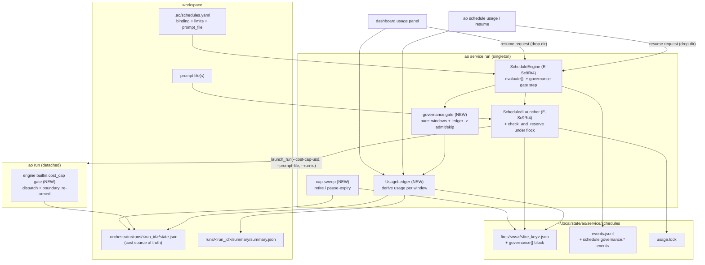
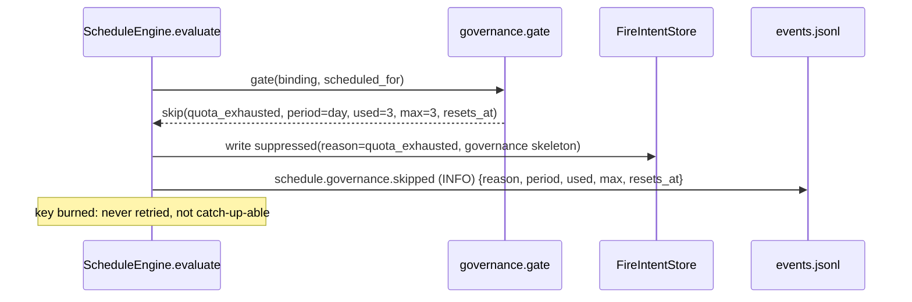
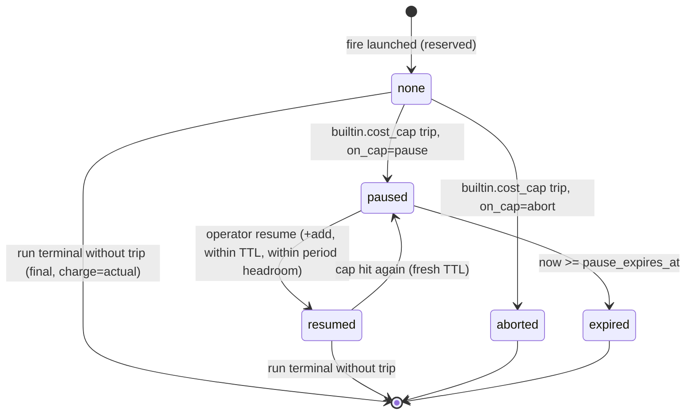
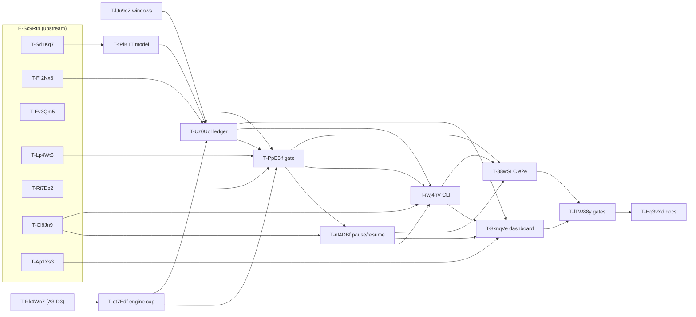

# Scheduled-run governance — fixed prompts, per-period quotas, cost caps — HLD + LLD (E-Qp4Zm8)

- Status: **Partially implemented (2026-11-11, branch `ad/enhancements-10nov`) — NOT closed, NOT "Implemented".** Everything in §26.1 and §26.2 is committed: window math, binding `limits` model, pre-fire gate + reservation, derived usage ledger, the engine cost-cap gate, pause/resume/expiry (`service/capped_resume.py`), the `ao schedule usage/resume/set-limits/pin-prompt` commands, `ao run/resume --cost-cap-usd` the dashboard usage route, paused-runs list and the bounded `resume-capped` route (`4f6bbc1`). What is **unfinished** is listed in §26.4 (ticket rollup: `meta/tickets/E-Qp4Zm8-scheduled-run-governance/STATUS.md`, which wins over this text). Where §1–§24 (the design) and §26 disagree, **§26 and the code win**. Builds on E-Sc9Rt4 (mostly shipped, also not closed).
- Related: [`ADR-0025`](adr/ADR-0025-scheduled-run-governance-quotas-and-cost-caps.md) (this epic's decisions) ·
  [`scheduler-triggers-hld.md`](scheduler-triggers-hld.md) (which links back; §9.1 CLI, §12 events) + [`ADR-0014`](adr/ADR-0014-service-owned-scheduler-and-triggers.md)
  (the firing mechanism this epic extends) · operator walkthrough with captured CLI output: [`run-options-and-limits-guide.md`](run-options-and-limits-guide.md#walkthrough-a-recurring-job-with-limits-schedule--usage--cap-hit--pause--resume) · [`lld-run-control-routing-breakers.md`](lld-run-control-routing-breakers.md)
  (ADR-RC-004: every breaker action lands on resumable `failed`) · [`ADR-0016`](adr/ADR-0016-overseer-runner-cadence-and-budget-governance.md)
  (D2/D9: breaker latching, re-armed $0 containment) · [`ADR-0004`](adr/ADR-0004-agent-monitoring-guardrail-modes.md)
  (`hard`/`recommend`) · [`ADR-0019`](adr/ADR-0019-cross-run-result-cache.md) D7 (argv-hashed cache key) ·
  [`ADR-0021`](adr/ADR-0021-dashboard-authentication-and-totp.md) (dashboard auth, deny-by-default) ·
  epic ticket [`meta/tickets/E-Qp4Zm8-scheduled-run-governance/EPIC.md`](../meta/tickets/E-Qp4Zm8-scheduled-run-governance/EPIC.md) ·
  narrative [`ai-epics/E-Qp4Zm8-scheduled-run-governance.md`](ai-epics/E-Qp4Zm8-scheduled-run-governance.md)

---

## 1. Requirements

### 1.1 The ask (verbatim, owner, 2026-11-10)

> "I should be able to invoke the AO runs with some fixed prompts periodically, with some required constraints, ...
> invocations per specified period, like per day, per week or something like that. And the cost or something like that
> per iteration."

### 1.2 Locked owner decisions (not re-litigated)

| # | Decision | Where this design honors it |
|---|---|---|
| D-1 | Standalone follow-up epic on top of E-Sc9Rt4, sequenced after its engine-core + binding-model work. | §4, §17 (every interface delta named) |
| D-2 | Every recurring job MUST declare at least one limit; a job with no limit is rejected at validation. No opt-out. | §6.2 validator `LIMITS_REQUIRED` |
| D-3 | Quota/cost-cap hit at fire time ⇒ skip the fire and record it (dashboard + structured log). No notifications. | §8.1, §12, §13 |
| D-4 | Quota windows are calendar-aligned in the schedule's own timezone. | §7 |
| D-5 | The per-run cost cap applies **mid-run** (pause or abort). Architect chooses; define resume/expiry. | §9 (recommendation: `on_cap: pause` default, `abort` available) |

### 1.3 Functional requirements (refined; traceability lives in the epic ticket)

- **FR-1 Fixed prompt.** A governed binding names its prompt **by path** (`prompt_file`, existing E-Sc9Rt4 field). Each
  fire reads the file once, records `sha256`, byte length and path in its fire record, and passes exactly those bytes to
  the run. Optional `prompt_sha256` pin: a mismatch skips the fire (`prompt_changed`). `ao schedule add --prompt TEXT`
  writes the text to `.ao/schedule-prompts/<id>.md` and references it, so inline text never lands in `schedules.yaml`.
- **FR-2 Invocation quotas.** `limits.quotas: [{period: day|week|month, max_runs: N}]`, calendar-aligned in the binding's
  timezone, `week_start` configurable. A fire beyond any quota is skipped (`quota_exhausted`), its key is burned, and
  the skip is recorded.
- **FR-3 Per-run cost cap, mid-run.** `limits.cost.per_run_usd` becomes the run's `--cost-cap-usd`. The engine enforces
  it with a new **re-armed, non-latching** built-in gate (`builtin.cost_cap`) at every dispatch and every task boundary.
  When reached, the run stops dispatching, drains in-flight tasks, and lands on resumable `failed` with a
  `TrippedBreaker(id="builtin.cost_cap", action="pause"|"abort")`. *Correction to the draft:* this is **not** `budget.py`
  — that module meters tokens only (`BudgetSpec.total_tokens`, `RateLimit.tokens`) and has no USD concept.
- **FR-4 Per-period cost cap.** `limits.cost.periods: [{period, max_usd}]`. Checked before each fire against
  `actual spend + in-flight reservations` in the window; a fire that cannot afford its reservation is skipped
  (`cost_cap_reached`). The fire's reservation is also passed down as its run cap, so the period cap is enforced mid-run
  too (§8.3).
- **FR-5 Observability.** `ao schedule usage` and a dashboard usage panel show, per schedule and window: runs used/max,
  spend (actual + reserved)/max, reset time, paused-by-cap runs with expiry, and the last N governance events.
- **FR-6 Pause lifecycle.** A paused-by-cap run is resumable by an explicit operator action (`ao schedule resume`,
  dashboard button) within `pause_ttl_seconds` (default 72 h), adding a bounded amount of budget that is checked against
  the fire's window. After the TTL it is `expired`. The scheduler **never** auto-resumes a capped run.

### 1.4 Non-functional

- **NFR-1 Crash-safety / no double count.** Usage is *derived* from durable fire records + each run's `state.json`; the
  reservation is persisted in the same atomic write as the fire intent, before launch. Restart re-derives identical
  numbers. A fire contributes to a window exactly once (keyed by `fire_key`).
- **NFR-2 Safe by default.** D-2; unknown cost is charged conservatively (§10.4); a cost cap that fails to reach the run's
  argv fails the launch closed (§8.4).
- **NFR-3 Determinism.** Window math and gating are pure functions of (records, clock, tz); every test uses fixed clocks.
- **NFR-4 Backward compatibility.** No `.ao/schedules.yaml` ⇒ no change. `ao run` without `--cost-cap-usd` is
  byte-identical (no new `clock()` calls; same `state.json` shape apart from defaulted new fields).
- **NFR-5 Bounded overhead.** Gate cost is O(fires in the widest open window), with an mtime-keyed `state.json` cache;
  stays inside E-Sc9Rt4's `SCHEDULE_TICK_BUDGET_SECONDS = 0.5`.
- **NFR-6 Quality gate.** Same as E-Sc9Rt4 NFR-6 (pytest delta reported, ruff/format clean, mypy no regression,
  ≥ 80 % coverage on new modules).

## 2. Scope

| In | Out |
|---|---|
| `limits` on bindings + defaults, JSON Schema + pydantic, D-2 validator | New trigger kinds (E-Sc9Rt4) |
| Pure window math (day/week/month, tz, DST, week-start) | Notifications/alerting (D-3); revisit later |
| Usage ledger derived from fire records + `state.json` | Billing/provider-invoice integrations |
| Pre-fire gate + atomic reservation; fail-closed launch | Workspace-wide or service-wide shared spend pools (FR-9 non-MVP) |
| Engine `--cost-cap-usd` + `builtin.cost_cap` gate; sticky across resume | Token-denominated caps (FR-7 non-MVP) |
| Pause/abort lifecycle, operator resume, TTL expiry | Killing in-flight tasks on cap (§9.3, rejected) |
| `ao schedule` flags, `ao schedule usage`, `ao schedule resume` | Per-dispatch `--max-budget-usd` allowance (FR-8 non-MVP, §9.5) |
| Dashboard usage panel + governance event feed | Changes to `budget.py` / `BudgetCounters` semantics |

## 3. Assumption log

| ASSUMPTION | Risk if wrong | Mitigation |
|---|---|---|
| E-Sc9Rt4 lands as designed (binding model, fire store, engine, launcher, CLI, panel). | Interface drift breaks this design. | Every task here says "read the merged code, not the HLD" (E-Sc9Rt4's own rule); §17 lists the exact seams. |
| The Claude CLI's final `result` event carries `total_cost_usd` (verified: `executors/claude_cli.py:482-486`). | No USD cost ⇒ cost caps blind. | §10.4 conservative charging + `cost_confidence`. |
| USD cost is only visible when a task **settles** (no running cost in stream-json assistant events). | — (verified: cost parsed only from the result event). | §9.2 states the overshoot bound explicitly. |
| One `ao service run` daemon per user (E-Sc9Rt4 singleton lock). | Two evaluators double-reserve. | Gate also takes a governance flock (§8.2) so the no-daemon CLI path is safe too. |
| `--cost-cap-usd` is only forwarded if it is in the run-options registry (`run_options.OPTIONS` → `allowed_options()`; `ui/processes.py::_render_options` **silently drops** anything else). | Cap silently missing ⇒ unbounded run. | Registry entry + launcher asserts the flag is in the rendered argv, else `launch_failed` (§8.4). |

## 4. Prior-art audit — what exists (verified in `src/`)

| Need | What exists today | Use |
|---|---|---|
| Actual USD per task | `TaskResult.cost_usd` from `total_cost_usd` (`executors/claude_cli.py:484`); mirrored to `TaskRunState.cumulative_cost_usd` (`models.py:1616`) at settle | Cost source of truth |
| Run total | `compute_run_usage_totals(state).cost_usd` (`models.py`, derived, resume-safe; includes sentinel generation rows) | Ledger + engine gate |
| Summary cost | **Not** in `state.tasks`; `<run_dir>/summary/summary.json` `summary_cost_usd` (`summarizer.py:130,271`), bounded at `SUMMARY_MAX_COST_FRACTION = 0.02` except the final summary | Ledger adds it (§10.2); the in-run gate does not (documented) |
| USD breaker | `run_cost_usd` / `task_cost_usd` registered (`breakers.py:419`), evaluated at task boundaries (`engine.py:2810`) | **Not reused directly** — latches (§9.1) |
| Breaker actions | `fail/stop/pause` all ⇒ resumable `status="failed"` (`breakers.py::map_action`, ADR-RC-004); `RunState.status ∈ {running, succeeded, failed, cancelled}` | Pause = resumable failed |
| Halt behavior | Halt ⇒ `_drain_remaining` waits for in-flight workers ("drain, don't kill", ADR-0007 D7, `engine.py:3334`, `_drain_remaining`) | Overshoot bound (§9.2) |
| Latching | `evaluate_breakers`: `if spec.id in already_tripped: continue` — a tripped id never trips again; ADR-0016 D2 already flags "after any trip a plain `ao resume` has no engine wall" | Why we need a re-armed gate |
| Extension | `ao resume --extend-breaker <id>` → `apply_breaker_extension` — but only ids in `wf.circuit_breakers` (`cli.py:2011-2118`, `apply_breaker_extension`) | Not usable for a built-in; new `--cost-cap-usd` on resume instead |
| Built-in trip recording | `record_trip(... BUILTIN_BUDGET_EXHAUSTED ...)` (`engine.py:1820`), ids in `models.py:131-135` (`BUILTIN_COST_CAP` is `models.py:135`) | Add `BUILTIN_COST_CAP = "builtin.cost_cap"` |
| Sentinel budget | `GenerationLane(run_cost_cap_usd=...)` derived only from `run_cost_usd` breakers (`engine.py:3006-3035`, `_start_llm_lane`; now `min(breaker cap, RunState.cost_cap_usd)`) | Must also see the new cap |
| Monitor extension | `mode: recommend` breakers may be auto-extended; built-ins never reach the consult (`engine.py` boundary block ~2790-2830: the cost-cap check at 2806 runs before `evaluate_breakers` at 2810) | Cost cap is a built-in ⇒ always hard |
| Launch | `ProcessSupervisor.launch_run(prompt=..., options=...)` writes the prompt to a launch file, passes `--prompt-file` (`ui/processes.py:399-452`); `launch_resume` exists | Fire + capped resume |
| Kill | `ProcessSupervisor.cancel` SIGTERMs the process group then SIGKILL after 10 s | Considered for abort; rejected (§9.3) |
| Dashboard auth | Optional, deny-by-default `AuthMiddleware` (`ui/app.py:228`); routes without a policy entry are `AUTHENTICATED` | New routes inherit it (§14) |
| `ao run --run-id` | Re-verify before relying on it (was absent at design time; E-Sc9Rt4 T-Ri7Dz2) | Dependency |
| `schedules/`, `service/schedule_engine.py`, `fire_store.py`, `schedule_launch.py` | **Present** since E-Sc9Rt4 landed (2026-11-11 audit refresh) | Dependencies |

**Drift found in E-Sc9Rt4's design (fix in its tasks, not here):** its HLD §3.3 and T-Ri7Dz2 AC4 treat `ALLOWED_OPTIONS`
as a hand-edited dict ("add the one entry"). It is now **derived** from the run-options registry
(`run_options.py::allowed_options()`, only options with a `ui_group`). `run_id` must become a registry `Option` (or an
explicit `launch_run` kwarg); otherwise `options={"run_id": ...}` is silently dropped. The same trap applies to this
epic's `cost_cap_usd`, which is why §8.4 makes the launcher verify the rendered argv.

## 5. Architecture

### 5.1 Block diagram



### 5.2 Module layout (new code is additive; owners in §20)

```
src/agent_orchestrator/
  schedules/
    governance.py     NEW  pydantic LimitsSpec/QuotaSpec/CostLimits/PeriodCostCap + D-2 validator
    windows.py        NEW  pure calendar-window math (day/week/month, tz, DST, week_start)
    models.py         EDIT ScheduleBinding/ScheduleDefaults gain `limits`, `prompt_sha256`, `week_start`
  service/
    usage_ledger.py   NEW  UsageLedger: derive per-window usage; FireGovernance record type; cost probe cache
    governance_gate.py NEW pure gate(binding, now, ledger) -> GateResult; check_and_reserve()
    schedule_engine.py EDIT one gate step in evaluate(); retire hook; pause-expiry sweep; snapshot usage
    schedule_launch.py EDIT reserve-in-intent, prompt hash, cost cap option, argv verification, capped resume
    fire_store.py     EDIT FireIntentRecord.governance (optional sub-model)
  engine.py           EDIT builtin.cost_cap gate at dispatch + boundary; sentinel cap feed
  models.py           EDIT BUILTIN_COST_CAP; RunState.cost_cap_usd (+source) defaulted
  run_options.py      EDIT Option("cost_cap_usd", float, --cost-cap-usd, CLI-only, GROUP_CONCURRENCY)
  cli.py              EDIT `ao run`/`ao resume` --cost-cap-usd wiring (sticky on resume)
  schedules/cli.py    EDIT `ao schedule add` limit flags; `usage`; `resume`; list/history columns
  ui/service.py, ui/app.py, ui/src/components/Schedules.tsx (+ ScheduleUsage.tsx)  EDIT/NEW
specs/schedules.schema.json  EDIT $defs.limits etc.
```

Dependency direction (unchanged rule from E-Sc9Rt4): `schedules/` imports nothing from `service/`; `windows.py` and
`governance.py` are pure; the engine core (`engine.py`) learns only a float cap and never imports `schedules/`.

## 6. Data model — binding schema deltas

### 6.1 YAML

```yaml
version: "1.0"
defaults:
  timezone: Europe/Berlin
  week_start: monday            # NEW  monday | sunday   (ISO default: monday)
  limits:                       # NEW  inherited wholesale when a binding has no `limits` (no deep merge)
    quotas: [{period: day, max_runs: 3}]

schedules:
  - id: daily-triage
    kind: cron
    schedule: "0 9 * * 1-5"
    template: routed-runner
    params: {repo_set: ao}
    prompt_file: prompts/daily-triage.md     # existing E-Sc9Rt4 field; the FIXED prompt
    prompt_sha256: null                      # NEW optional pin (64 hex); mismatch => skip
    limits:                                  # NEW — required (here or via defaults), D-2
      quotas:
        - {period: day,  max_runs: 3}
        - {period: week, max_runs: 10}
      cost:
        per_run_usd: 2.00                    # -> ao run --cost-cap-usd (mid-run, D-5)
        on_cap: pause                        # pause (default) | abort
        pause_ttl_seconds: 259200            # 72 h; ignored for abort
        periods:
          - {period: week, max_usd: 20.00}
```

Semantics, stated once:

- **Window instant.** Membership of a fire in a window is decided by its `scheduled_for` (the logical instant that
  also derives `fire_key`), never by jittered or actual launch time. Run-now fires use `scheduled_for = requested_at`
  (E-Sc9Rt4 §6.9), so they count in the window they were requested in.
- **What counts as an invocation.** Fire records with status `intended`, `launched` or `orphaned`. Not
  `suppressed` (incl. this epic's own skips) and not `launch_failed`. `orphaned` counts because at-most-once already
  treats its slot as consumed (ADR-0014 D5); counting it is the conservative reading.
- **Cost attribution.** A fire's *whole* run cost (including any resumed continuation) is charged to the windows that
  contain its `scheduled_for`. See §10.5 for why per-spend-time attribution is not used.
- **`until.max_runs` is not a D-2 limit.** It is a lifetime cap, not a per-period one; D-2 asks for "quota and/or cost
  cap". (Listed in §21 with this default.)

### 6.2 Pydantic (`schedules/governance.py`)

```python
Period = Literal["day", "week", "month"]
WeekStart = Literal["monday", "sunday"]
OnCap = Literal["pause", "abort"]

MAX_QUOTA_RUNS: Final = 10_000
MAX_USD: Final = 100_000.0
MIN_RESERVATION_USD: Final = 0.10           # below this remaining budget, a fire is not worth starting
DEFAULT_PAUSE_TTL_SECONDS: Final = 72 * 3600
MAX_PAUSE_TTL_SECONDS: Final = 30 * 86400
MAX_RESUME_FACTOR: Final = 1.0              # a single resume may add at most per_run_usd x this

class QuotaSpec(BaseModel):
    model_config = ConfigDict(extra="forbid")
    period: Period
    max_runs: int = Field(ge=1, le=MAX_QUOTA_RUNS)

class PeriodCostCap(BaseModel):
    model_config = ConfigDict(extra="forbid")
    period: Period
    max_usd: float = Field(gt=0, le=MAX_USD, allow_inf_nan=False)

class CostLimits(BaseModel):
    model_config = ConfigDict(extra="forbid")
    per_run_usd: float | None = Field(default=None, gt=0, le=MAX_USD, allow_inf_nan=False)
    on_cap: OnCap = "pause"
    pause_ttl_seconds: int = Field(default=DEFAULT_PAUSE_TTL_SECONDS, ge=0, le=MAX_PAUSE_TTL_SECONDS)
    periods: list[PeriodCostCap] = []

    @model_validator(mode="after")
    def _one_per_period(self) -> "CostLimits": ...      # duplicate period => error naming it
    @model_validator(mode="after")
    def _per_run_fits_periods(self) -> "CostLimits": ... # per_run_usd > min(periods.max_usd) => error
                                                        # (that run could never be afforded)

class LimitsSpec(BaseModel):
    model_config = ConfigDict(extra="forbid")
    quotas: list[QuotaSpec] = []
    cost: CostLimits | None = None

    @model_validator(mode="after")
    def _one_quota_per_period(self) -> "LimitsSpec": ...

    def declares_any_limit(self) -> bool:                # D-2
        return bool(self.quotas) or (
            self.cost is not None and (self.cost.per_run_usd is not None or bool(self.cost.periods)))
```

`ScheduleBinding` (E-Sc9Rt4 T-Sd1Kq7) gains:

```python
limits: LimitsSpec | None = None            # None => inherit defaults.limits
prompt_sha256: str | None = Field(default=None, pattern=r"^[0-9a-f]{64}$")
week_start: WeekStart | None = None         # None => defaults.week_start ("monday")

# ScheduleFile-level validator (runs after defaults are applied):
LIMITS_REQUIRED = "schedule {id!r}: every schedule must declare at least one limit (limits.quotas, " \
                  "limits.cost.per_run_usd or limits.cost.periods) — here or in defaults.limits (D-2)"
# also: prompt_sha256 without prompt_file => error; `cost_cap_usd` key inside run_args => error
#       ("set limits.cost.per_run_usd instead") so the cap has exactly one source.
```

`RunArgs` (closed model over the run-options allow-list) therefore explicitly **excludes** `cost_cap_usd` even though
the registry now allow-lists it for the dashboard.

### 6.3 JSON Schema delta (`specs/schedules.schema.json`)

`specs/schedules.schema.json` is **generated from the pydantic models** (`ScheduleFile.model_json_schema(by_alias=True)`;
`test_checked_in_schema_matches_model` fails on drift), not hand-written. The governance delta therefore appears as
pydantic emits it: `$defs` named after the classes (`QuotaSpec`, `PeriodCostCap`, `CostLimits`, `LimitsSpec`, plus
`Period`/`WeekStart` enums), `additionalProperties: false` on each, and the numeric bounds below:

| field | schema |
|---|---|
| `QuotaSpec.max_runs` | `integer`, 1..10000 |
| `PeriodCostCap.max_usd` | `number`, `exclusiveMinimum: 0`, `maximum: 100000` |
| `CostLimits.per_run_usd` | `number` or `null`, same bounds |
| `CostLimits.on_cap` | `enum [pause, abort]`, default `pause` |
| `CostLimits.pause_ttl_seconds` | `integer`, 0..2592000, default 259200 |

`binding.properties` gains `limits`, `prompt_sha256` (`pattern ^[0-9a-f]{64}$`), `week_start`; `defaults.properties`
gains `limits`, `week_start`.

**What the schema does *not* express (pydantic is authoritative).** There are no `anyOf` "at least one limit"
constraints: D-2 ("every schedule declares a limit, here or in `defaults.limits`") depends on inheritance, which JSON
Schema cannot state, so it is enforced only by the `ScheduleFile` validator. The same goes for uniqueness per
period, `per_run_usd <= min(period max_usd)`, and `prompt_sha256` requiring `prompt_file`. The schema validates
shape only — the same split E-Sc9Rt4 uses for its cross-field rules. Consequence: `limits: {cost: {on_cap: abort}}`
passes the schema but is rejected on load, and `{quotas: [...], cost: {on_cap: abort}}` is valid in both.

**Deliberate deviations from the §6.2 sketch (T-tPlK1T).**
- The numeric limit fields are strict, so a quoted `"3"` or `true` is an error rather than a silent coercion
  (matching `run_args`). The integer fields (`max_runs`, `pause_ttl_seconds`) additionally accept an *integral float*
  (`3.0`, normalised to `3`) because JSON Schema treats `3.0` as a valid `integer`; `3.5` is rejected by both.
- `prompt_sha256` with a trailing newline (`"<64 hex>\n"`) is rejected by pydantic's Rust regex but accepted by
  Python-`re` based `jsonschema` (where `$` matches before a final `\n`; ECMA-262 validators reject it). Fail-closed,
  so accepted as a known pydantic-only rejection rather than papered over.
- `limits_digest` identity means *same enforcement*, not same YAML: a `cost` block with neither `per_run_usd` nor
  `periods` is inert and hashes like an absent `cost`.
- `save()` writes every default (`on_cap`, `pause_ttl_seconds`, `periods: []`, ...) into the file on first save;
  a later change to `DEFAULT_PAUSE_TTL_SECONDS` therefore does not reach files already saved.

### 6.4 Fire-record delta (`service/fire_store.py`, E-Sc9Rt4 T-Fr2Nx8)

`FireIntentRecord` gains one optional sub-object, written in the **same atomic `intended` write** (ADR-0014 D5):

```json
"governance": {
  "schema": "ao.schedule.governance/v1",
  "limits_digest": "sha256:…",           // canonical JSON of the effective LimitsSpec at fire time
  "tz": "Europe/Berlin", "week_start": "monday",
  "prompt": {"path": "prompts/daily-triage.md", "sha256": "…", "bytes": 1834},
  "reserved_usd": 2.0,                   // reservation held while the run can still spend
  "run_cost_cap_usd": 2.0,               // value passed as --cost-cap-usd (== reserved_usd at fire)
  "on_cap": "pause", "pause_ttl_seconds": 259200,
  "cost_observed_usd": 0.0,              // high-water mark; never decreases (§13.3)
  "cost_confidence": "pending",          // pending | actual | partial | unknown
  "cap_state": "none",                   // none | paused | aborted | expired | resumed
  "paused_at": null, "pause_expires_at": null,
  "resumes": [],                         // [{at, by, add_usd, new_cap_usd, request_id}]
  "final": false                         // true once no further spend is possible via governance
}
```

Cap-state classification (M3): a retired run is `paused`/`aborted` only if `status=failed` **and** it carries a
`builtin.cost_cap` trip whose `at` is later than the latest `resumes[].at` (any trip when there are no resumes). The trip list
is append-only and never cleared, so an earlier trip must not make a later non-cap failure look like a cap pause.

`governance: null` for a binding that predates this epic is impossible after D-2 (every binding has limits), but the
field is optional so E-Sc9Rt4's own tests and records stay valid.

## 7. Window math (`schedules/windows.py`) — D-4

> **Review amendment (L5): the local-date label is authoritative.** Window membership is decided by the key
> (`day:YYYY-MM-DD` …); `start <= t < end` is derived to agree with it. The two agree in every zone checked (Havana,
> Santiago 24:00, Beirut midnight gap) and could diverge only for a fall-back after local midnight (tzdata has such cases before 2011: America/Moncton
> 1993, America/St_Johns 1987, Antarctica/Casey 2010; the label wins). The test corpus adds
> America/Santiago 2024-04-07 and Asia/Beirut 2024-03-31.

Pure, stdlib-only (`zoneinfo`), no clock reads.

```python
@dataclass(frozen=True)
class Window:
    period: Period
    key: str            # "day:2026-11-10" | "week:2026-11-09" | "month:2026-11"   (local calendar labels)
    start: datetime     # aware UTC, inclusive
    end: datetime       # aware UTC, exclusive (== start of next window)

def window_for(instant: datetime, period: Period, tz: ZoneInfo, week_start: WeekStart) -> Window: ...
def windows_for(instant, periods, tz, week_start) -> dict[Period, Window]: ...
```

```
FUNCTION window_for(instant, period, tz, week_start):
  REQUIRE instant.tzinfo IS NOT NULL                       # naive => ValueError (never guess)
  local = instant.astimezone(tz)
  d = local.date()
  IF period == "day":   start_d = d;                         next_d = d + 1 day
  IF period == "week":  offset = (d.weekday() - (0 IF week_start=="monday" ELSE 6)) mod 7
                        start_d = d - offset days;           next_d = start_d + 7 days
  IF period == "month": start_d = d.replace(day=1);          next_d = first day of following month
  start = local_midnight(start_d, tz);  end = local_midnight(next_d, tz)
  key   = f"{period}:{start_d.isoformat()}"  (month: f"month:{start_d:%Y-%m}")
  RETURN Window(period, key, start, end)

FUNCTION local_midnight(date, tz) -> aware UTC:
  # Earliest instant whose local date is `date`.
  cand = datetime.combine(date, time(0, 0), tzinfo=tz)       # fold=0
  u = cand.astimezone(UTC)
  # Gap at midnight (e.g. America/Havana 2024-03-10): zoneinfo resolves the non-existent 00:00 with the
  # pre-transition offset, and u.astimezone(tz) == 01:00 the same date, i.e. the first existing instant.
  # Overlap at midnight (fold): fold=0 picks the FIRST 00:00, so the day starts at its first occurrence.
  RETURN u
```

Properties (each is a unit test):

- **Membership is label-based.** `window_for(t).key` depends only on the *local date* of `t`, so a DST fall-back day
  (25 h) and spring-forward day (23 h) are each exactly one window, and an instant in the repeated hour belongs to that
  day regardless of `fold`. `start <= t < end` holds for every `t`.
- **Store instants, derive keys.** The ledger stores `scheduled_for` instants, never window keys. Changing a binding's
  `timezone` or `week_start` re-buckets history deterministically on the next evaluation — no double quota, no lost
  quota. (Stated limitation: such a change can move past fires into or out of the *current* window; it is an operator
  action. Each fire records the `limits_digest` it was gated under, but no `limits_changed` event is emitted — design intent only, not implemented.)
- **E-Sc9Rt4's DST fall-back double fire is now contained.** A daily 01:30 cron in a DST zone fires twice on fall-back
  day (ADR-0014 known limitation). Both instants land in the same `day:` window, so a `{period: day, max_runs: 1}`
  quota skips the second. Pinned by a test.
- A week window is 7 consecutive local dates (167 h / 169 h across a DST change), or fewer if the zone skips a date
  (Pacific/Apia 2011-12-30); month windows use the local calendar month (28–31 days).

## 8. Enforcement point 1 — the pre-fire gate

### 8.1 Placement inside E-Sc9Rt4's `evaluate()`

E-Sc9Rt4 T-Ev3Qm5's normative check order is:
`status/enabled -> until -> queued-drain -> next_fire -> backlog collapse -> not_due -> jitter -> lateness/catch-up ->
already_fired -> overlap -> concurrency -> FIRE`.

This epic inserts **one** step, between `overlap` and `concurrency`:

```
... -> already_fired -> overlap -> GOVERNANCE -> concurrency -> FIRE
```

Why exactly there:

- **After `already_fired`** so a re-evaluated instant that already has a record is never re-gated or re-counted.
- **After `overlap`** so an overlap-skipped instant burns its key as `overlap` (the true cause), not as a quota skip.
- **Before `concurrency`** because governance skips **burn the key** (D-3: "skip"), while concurrency does not. If
  concurrency came first, a concurrency-blocked fire would be retried next tick and then gated — which is also fine —
  but placing governance first means a fire that is over quota is recorded as `quota_exhausted` deterministically
  instead of flapping between `concurrency` and `quota_exhausted` events across ticks.
- **`queue`-overlap drain path (M2).** A queued fire (E-Sc9Rt4 `queued_fire_key`) is gated when it is drained, using its
  original `scheduled_for`. E-Sc9Rt4 §6.3 step 3 returns `FIRE(from_queue=...)` *before* `next_fire`/`already_fired`/
  overlap/concurrency, so the inserted step above does not run there: this is a **second governance call site**.
  `ScheduleState` stores only `queued_fire_key` (a hash), so the window instant cannot be recovered. **E-Sc9Rt4 T-Ev3Qm5
  must store `queued_scheduled_for` next to it.** If the gate rejects the drained fire, the queued key is cleared and
  burned with the governance reason in its **original** window.

Why governance skips burn the key (and concurrency's do not): quota never frees inside the fire's grace window (it
resets at a window boundary, which is later than any grace), and cost headroom freeing up mid-grace (a sibling settles
under its reservation) is a rare, small win that would make skip behavior time-dependent and harder to explain.
Deterministic "skipped, here is why" is the D-3 contract.

### 8.2 Gate algorithm (`service/governance_gate.py`)

```python
@dataclass(frozen=True)
class GateResult:
    admit: bool
    reason: str | None                   # None | "quota_exhausted" | "cost_cap_reached" | "prompt_missing"
                                         #      | "prompt_changed" | "governance_error"
    reservation_usd: float | None        # None when the binding has no cost limits
    detail: dict                         # {"period": "week", "used": 10, "max": 10, "resets_at": "..."} etc.

def gate(binding, effective_limits, scheduled_for, *, ledger, tz, week_start) -> GateResult: ...
def check_and_reserve(decision, *, ledger, fires, lock_path, now) -> GateResult: ...
```

```
FUNCTION gate(b, L, scheduled_for, ledger, tz, ws):
  windows = windows_for(scheduled_for, all periods named in L.quotas ∪ L.cost.periods, tz, ws)
  usage   = ledger.usage(workspace, b.id, windows)           # §10: {period: WindowUsage(runs, actual, reserved)}

  FOR q IN L.quotas (declared order):
      u = usage[q.period]
      IF u.runs >= q.max_runs:
          RETURN skip("quota_exhausted", period=q.period, used=u.runs, max=q.max_runs, resets_at=windows[q.period].end)

  reservation = None
  IF L.cost:
      remaining = min( (c.max_usd - usage[c.period].actual - usage[c.period].reserved) FOR c IN L.cost.periods ),
                  default = +INF
      IF L.cost.per_run_usd IS NOT NULL:
          IF remaining < L.cost.per_run_usd:            # a run is only started if it can afford its full cap
              RETURN skip("cost_cap_reached", period=<argmin>, remaining=remaining, needed=L.cost.per_run_usd, ...)
          reservation = L.cost.per_run_usd
      ELSE:                                             # period cap(s) only: the run's cap is what is left
          IF remaining < MIN_RESERVATION_USD:
              RETURN skip("cost_cap_reached", period=<argmin>, remaining=remaining, needed=MIN_RESERVATION_USD, ...)
          reservation = round_down_cents(remaining)
  RETURN admit(reservation)

FUNCTION check_and_reserve(d, ledger, fires, lock_path, now):          # called by ScheduledLauncher
  WITH flock(lock_path):                                # <state_dir>/schedules/usage.lock (exclusive)
      ledger.invalidate(d.workspace_root, d.schedule_id)  # re-read records written earlier this tick
      g = gate(d.binding, d.effective_limits, d.scheduled_for, ledger=ledger, ...)
      IF NOT g.admit:
          fires.write_suppressed(d.fire_key, reason=g.reason, governance=skeleton(d, g))
          RETURN g
      prompt = read_prompt(d)                           # §11; may return skip("prompt_missing"|"prompt_changed")
      IF prompt IS skip: fires.write_suppressed(...); RETURN prompt
      fires.write(d.fire_key, status="intended", ..., governance=FireGovernance(
          reserved_usd=g.reservation_usd, run_cost_cap_usd=g.reservation_usd, prompt=prompt.meta, ...))
      RETURN g      # lock released; launch proceeds outside the lock (Popen is non-blocking anyway)
```

Two gate calls, one authority: `evaluate()` calls `gate()` to produce the *reason* (so `FireDecision` and `ao schedule
next` can explain themselves without launching), and the launcher calls `check_and_reserve()` as the **authoritative**
check-and-write. This closes three races:

1. **Two decisions for one binding in a tick** (a natural fire plus a drained run-now request): the second
   `check_and_reserve` sees the first's `intended` record.
2. **No-daemon run-now** (`ao schedule run-now` executing in-process, E-Sc9Rt4 §6.9) concurrent with a daemon tick or
   another CLI: the flock serializes them.
3. **Crash between reserve and launch**: the reservation is *in* the intent record, so the orphan reconciler's outcome
   (`orphaned`) keeps counting the quota slot, and its cost charge is derived (§10.3), never lost.

### 8.3 Period caps are enforced mid-run too

Because the reservation becomes the run's `--cost-cap-usd`, the sum of all runs' caps in a window never exceeds the
window's period cap at the moment of reservation. Together with §9 the period cap therefore holds mid-run, up to the
same in-flight overshoot bound — without the engine knowing anything about periods.

### 8.4 Fail-closed launch

`ScheduledLauncher` passes `options={..., "cost_cap_usd": reservation}` (plus E-Sc9Rt4's `run_id`). Because
`_render_options` silently drops non-allow-listed keys, the launcher **verifies the rendered argv** (`LaunchRecord`
carries `argv`, E-Sc9Rt4 already hashes it into `argv_digest`) contains `--cost-cap-usd <value>` whenever a reservation
exists. If not, it SIGTERMs the just-spawned child via `ProcessSupervisor.cancel`, marks the record `launch_failed`
(`reason="cost_cap_not_forwarded"`), and emits `schedule.governance.launch_unsafe` at ERROR. Pre-spawn verification is
better still: the launcher renders the options dict with the same `run_options.allowed_options()` table
`_render_options` uses (read-only import; `ui/processes.py` is not edited) and refuses to spawn if the flag would be
dropped — the post-spawn check is the belt to that braces.

### 8.5 Sequence — gated fire

```mermaid
sequenceDiagram
  participant E as ScheduleEngine.evaluate
  participant G as governance.gate
  participant L as UsageLedger
  participant La as ScheduledLauncher
  participant F as FireIntentStore
  participant P as ProcessSupervisor
  participant R as ao run (detached)
  E->>E: ... already_fired? no; overlap ok
  E->>G: gate(binding, scheduled_for)
  G->>L: usage(windows)
  L->>F: fire records in widest window
  L->>L: charge(each) via state.json (mtime cache)
  G-->>E: admit(reservation=2.00)
  E->>E: concurrency ok -> FIRE
  E->>La: launch(decision)
  La->>La: flock(usage.lock)
  La->>G: gate again (authoritative)
  La->>La: read prompt, sha256, pin check
  La->>F: write intended + governance{reserved 2.00, prompt sha}
  La->>La: unlock
  La->>La: render options, assert --cost-cap-usd present
  La->>P: launch_run(prompt, options{run_id, cost_cap_usd=2.00})
  P->>R: Popen
  La->>F: update launched(pid, run_id)
  R->>R: builtin.cost_cap gate at every dispatch/boundary
```



## 9. Enforcement point 2 — the mid-run cost cap (D-5)

### 9.1 Why not just inject a `run_cost_usd` breaker

The obvious design — add `CircuitBreakerSpec(condition="run_cost_usd", action="pause", threshold=cap)` to the run —
is **unsafe on resume**. `evaluate_breakers` latches: once an id is in `state.tripped_breakers` it is skipped forever
(`breakers.py`, "latch: record at most once per id, ever"). ADR-0016 D2 already documents the consequence: *after any
trip a plain `ao resume` has no engine wall.* A paused-by-cap run that an operator (or a script) resumes with plain
`ao resume` would then spend without limit. `--extend-breaker` cannot help either: it only accepts ids declared in
`wf.circuit_breakers` (`cli.py:2011-2118`, `apply_breaker_extension`), and the scheduler cannot edit the workflow (template instances are rendered per
fire). Converting USD to `budget.py` tokens is rejected too: price per token differs per model, cache read/write tiers,
and the Claude CLI already reports the true USD figure.

### 9.2 Design: a sticky cap and a re-armed built-in gate

1. **`ao run --cost-cap-usd FLOAT`** — new run-options registry entry: `Option("cost_cap_usd", "float",
   flag="--cost-cap-usd", ui_group=GROUP_CONCURRENCY, ui_label="Cost cap (USD)", sticky_on_resume=True)`, **CLI-only** (no env, no config key),
   exactly like `budget_total`. Being in the registry makes it allow-listed for `launch_run`/`launch_resume` and visible
   in the dashboard's New-run form — a general feature, not scheduler-only.
2. **Persisted and sticky.** `RunState` gains `cost_cap_usd: float | None = None`. Changes are recorded in the existing
   `effective_settings_history` rather than a second `cost_cap_history` list (M5: derive, don't duplicate;
   `RunState.cost_cap_usd` stays because `effective_settings` is purely observational). *Sticky is a registry concept:*
   `Option.sticky_on_resume` plus a `SOURCE_STATE` provenance, so `_effective_settings_snapshot` reports "kept from state"
   (today `Option.resumable` means "resolved fresh each invocation", `run_options.py:85-87`). The value is validated
   **before** `resolve_option` (L1): that function treats falsy CLI values as unset, so `--cost-cap-usd 0` would otherwise
   silently mean "no cap". On `ao run`, the CLI value is stored. On `ao resume`, **absent flag ⇒ keep the persisted value** (deliberately unlike other options, which
   "resolve fresh each invocation"); `--cost-cap-usd X` sets a new absolute cap (must be `> 0`; a value `<=` current
   spend is accepted but prints a WARNING that the run will halt at its first dispatch). There is no way to *remove* a
   cap on resume short of editing `state.json` — intentional.
3. **`builtin.cost_cap` gate, re-armed by construction.** In the engine, a pure helper
   `cost_cap_reached(state) -> dict | None` returns `{cost_usd, cap_usd}` when
   `compute_run_usage_totals(state).cost_usd >= state.cost_cap_usd`. It is called:
   - **at dispatch prep**, before `budget.gate()`/`charge_estimate()` for every task (static, injected, loop clone,
     redispatch) — so no new work starts once the cap is reached, **including after any resume**;
   - **at the task boundary**, immediately before `evaluate_breakers` (`engine.py:2741`) — so the halt happens at the
     settle that revealed the breach, not only when something new is ready. **H1: the boundary trips only if some task is
     still non-terminal (pending, ready or blocked).** If the settle that crosses the cap leaves no work, the run finishes
     normally (`succeeded`) with the overshoot recorded in the ledger (§10.2); tripping would mark a finished run `failed`
     and offer a pointless resume. The dispatch-prep check alone already prevents new work; the boundary check is only an
     early halt.
   On a hit: `record_trip(state, BUILTIN_COST_CAP, condition="run_cost_usd", action=<"pause">, detail={...})` (the
   existing primitive, so the `TrippedBreaker` and `breaker.trip` event are byte-compatible), `state.status="failed"`,
   save, `DispatchPrep(signal="halt")` / `SettleResult(signal="halt")` → existing `_drain_remaining`. The helper does
   **not** consult `tripped_breakers`, so it re-arms on every invocation — the ADR-0016 D9 "re-armed $0 containment"
   idea moved into the engine for this one built-in.
4. **Never consultable.** It never builds a `CircuitBreakerSpec`, so it can never reach the `mode: recommend` monitor
   consult — the same "hard by construction" property E-XyfjuZ D1 gives the budget/quota built-ins.
5. **Sentinel lane sees it.** `_start_llm_lane` computes `cap` from `run_cost_usd` breakers only; it now also takes
   `state.cost_cap_usd` (min of both), so the sentinel's `budget_pct` and `--max-budget-usd` apply to scheduled runs.
6. **Byte-identical when unset.** `cost_cap_usd is None` ⇒ the helper returns immediately without calling `clock()`
   (the `evaluate_breakers` no-op guarantee, which several stepping-clock tests depend on).

**Seam with A3-D3 / T-Rk4Wn7 (M4).** D3 makes a failed task fail only its dependents and ends the run `failed` at the
end, with the invariant "a run with runnable work does not end failed with pending tasks". A cost-cap halt deliberately
leaves pending tasks, so that invariant **exempts breaker, budget and cost-cap halts**. Both tasks edit
`_settle_completed_task` and the run loop, so T-et7Edf is sequenced **after** T-Rk4Wn7 merges.

**Why resume-safe whole-run cost works (key enabler, not obvious).** `prepare_resume` (`runstate.py:540-546`) copies
`cumulative_cost_usd` into the reset `TaskRunState` and `_accumulate_actuals` (`engine.py:4052-4073`) uses `+=`, so run cost
survives resume and the sticky cap measures whole-run spend.

**Persisted cost visibility (H2).** `cost_confidence` (§10.2, §10.4) needs to know whether a task's cost was *observed*, but
`actuals_available` exists only on `TaskResult`. `TaskRunState` therefore gains defaulted `actuals_available: bool = False`
(sticky OR) and `attempts_without_actuals: int = 0` (every settled attempt reporting none, including killed ones), both set
in `_accumulate_actuals` and carried by `prepare_resume`. They are owned by T-et7Edf; T-Uz0Uol depends on them. The
`cumulative_cost_usd > 0` heuristic is rejected: a resumed task that reports later would mask an earlier blind attempt.

**Scriptable cost for tests (M6).** `FakeExecutor.token_outputs` carries tokens only and the CLI path builds
`FakeExecutor()` without a script (`executors/__init__.py:14`), so T-et7Edf adds `cost_usd` to `token_outputs` and a named
fixture seam (`fake_cost_script`). T-88wSLC and the CLI-e2e tier reference it.

The engine records `action="pause"` for every cost-cap trip. Pause vs abort is a **governance** property of the fire
(§9.4), not an engine state: the engine's behavior is identical (stop dispatching, drain, resumable `failed`), which is
also all ADR-RC-004 allows without a new status literal.

### 9.3 The hazard the owner should know about: accuracy lag and overshoot

D-5 says the cap applies mid-run. The engine can only act on cost it can see, and USD cost becomes visible **only when a
task settles** (the CLI's final `result` event carries `total_cost_usd`; assistant events carry tokens, not cost). So:

- **Overshoot bound.** Final run cost ≤ `cap` + Σ(cost of tasks in flight at the moment the cap was crossed). With
  `max_parallel = P` and a per-task worst case `C`, the bound is ≈ `P × C` (ADR-0016 D2 states the same bound for the
  overseer). Summaries add ≤ 2 % plus the final summary (§4). **Retries (T-lTW88y H-1, fixed):** `_run_with_retries`
  re-checks the cap between attempts of one dispatched task (settled run cost + that call's attempts so far ≥ cap stops
  further attempts), so a lane is bounded by the attempt that crosses the cap, not by `max_attempts × C`. Other lanes'
  unsettled spend stays invisible, so the bound remains ≈ `P × C` per crossing attempt.
- **Existing kills already under-count (M1).** Sentinel recovery already kills tasks (`sentinel_tick.py:570-590`: idle,
  stuck, cost) with `TaskResult.status="killed"`, and their spend is lost (`engine.py:4066`). A scheduled run with sentinel
  recovery on therefore under-reports to both the engine cap and the ledger. With `attempts_without_actuals` (§9.2) the
  ledger marks such runs `partial` and charges `max(observed, reserved)` while the fire's window is open. The in-run limit
  is documented in `guide-sentinel.md` and the governance guide.
- **Blind executors overshoot unboundedly (T-lTW88y I-6, accepted Info).** The retry-loop cap re-check above only works
  when the executor reports `cost_usd`. A *blind* executor (no `cost_usd` in its result) leaves settled cost at 0, so the
  engine cannot see any spend and keeps retrying past the cap: the review probe ran 4/4 attempts at a $0.01 cap. The
  in-task retry loop therefore does not bound blind attempts, and the overshoot is not capped at one attempt per lane.
  The ledger is the backstop: it charges `max(observed, reserved)` for the fire while its window is open, so period
  budgets stay conservative even though the in-run cap is not. Operators using a blind executor should rely on
  `max_attempts`, `run_args.max_parallel: 1` and the reservation, not on the per-run cap.
- **Why not kill in-flight tasks to tighten it ("hard abort")** — rejected, three reasons:
  1. A killed `claude -p` never emits its `result` event, so **its cost is never recorded** — `cumulative_cost_usd`
     stays 0 for spend that really happened. Killing to save money makes the ledger *under*-count, the one outcome
     NFR-1 forbids.
  2. ADR-0007 D7 ("drain, don't kill") exists so partial artifacts and `RunState` stay consistent and resumable; a
     SIGKILL mid-edit can leave a dirty working tree for the *next* scheduled run of the same workspace.
  3. It would not bound overshoot by much anyway: the cap is only *detected* at a settle, so in-flight siblings have
     already spent most of what they will spend.
- **Mitigations shipped:** (a) the reservation/cap is the period budget's unit, so overshoot is per-run, not
  cumulative; (b) the ledger records `overshoot_usd = max(0, engine − cap)` per fire (`engine` = the cap's own metric, the run's engine cost; the *charge* stays summary-inclusive) and the usage panel shows it, so
  the bound is observed, not assumed; (c) operators who need a tight bound set `run_args.max_parallel: 1`, making the
  bound one task (one attempt, since the retry loop stops at the cap).
- **Mitigation deferred (FR-8, non-MVP, needs its own small epic):** pass each Claude dispatch
  `--max-budget-usd <remaining unreserved run budget>` (the sentinel driver already does this, `sentinel_driver.py:113`),
  which lets the CLI stop *itself* and still report cost. It is not in MVP because `build_claude_argv`'s output is the
  cross-run result-cache key (ADR-0019 D7): a per-dispatch varying flag would turn every dispatch into a cache miss
  unless the flag is excluded from the key and `KEY_SCHEMA_VERSION` is bumped — a cache-epic decision, not ours.

### 9.4 Pause vs abort — recommendation

**Recommendation: configurable `on_cap: pause | abort`, default `pause`.** Both use the identical engine mechanism
(§9.2); they differ only in what governance allows afterwards.

| | `pause` (default) | `abort` |
|---|---|---|
| Engine effect | stop dispatch, drain in-flight, `status=failed` (resumable), `builtin.cost_cap` trip | identical |
| Governance `cap_state` | `paused`, `pause_expires_at = paused_at + pause_ttl_seconds` | `aborted`, `final = true` |
| `ao schedule resume` / dashboard Resume | allowed until expiry, adds a bounded amount (§9.5) | refused (`409`, "aborted by policy") |
| Manual `ao resume` (outside governance) | halts again at its first dispatch unless `--cost-cap-usd` is raised (sticky cap) | same |
| Reservation held | released (charge = observed) | released |
| Use when | the run's work is valuable and a human may judge it worth finishing | unattended jobs whose overrun is itself a signal to stop and fix the prompt/job |

Justification against existing semantics:

- **Matches ADR-RC-004.** `pause` is exactly what a breaker `action: pause` already means here (resumable failed) — no
  new `RunState.status` literal, no exit-code contract change.
- **Matches ADR-0014 D3's "no `replace`" reasoning.** Throwing away paid, unfinished work by default is the wrong
  default for multi-hour agent runs; pause preserves it, at zero ongoing cost (a paused run holds no process and no
  reservation).
- **Matches E-3JTmVu's extend-on-resume model.** Resuming with an explicit extra amount is the same shape as
  `--extend-breaker --extend-by-same`; the default top-up is `per_run_usd` ("extend by the same").
- **`abort` is cheap to offer** because it is governance-only, and it is the honest answer for jobs where "it cost too
  much" means "the job is broken". It is not the default because D-3 already makes the *next* fire the natural retry
  point, and an operator can always decline to resume a paused run — so `pause` never costs more than `abort` unless a
  human chooses to spend.

### 9.5 Resume and expiry of a paused run (FR-6)

```
FUNCTION request_capped_resume(workspace, schedule_id, run_id, add_usd=None, by="cli"|"ui"):
  rec = fires.find_by_run_id(workspace, run_id);  REQUIRE rec.schedule_id == schedule_id
  REQUIRE rec.governance.cap_state == "paused"            ELSE ResumeRefused(state)
  REQUIRE now < rec.governance.pause_expires_at            ELSE ResumeRefused("expired")
  add = add_usd OR binding.limits.cost.per_run_usd OR MIN_RESERVATION_USD
  REQUIRE 0 < add <= max_add(binding)                     # per_run_usd * MAX_RESUME_FACTOR, or remaining
  # Charged to the ORIGINAL fire's windows (attribution rule §6.1):
  remaining = min over period caps of (max_usd - usage(window_of(rec.scheduled_for)).actual - reserved)
  REQUIRE add <= remaining                                ELSE ResumeRefused("cost_cap_reached", remaining)
  new_cap = engine_cost_usd(rec) + add   # L3: the engine's metric (compute_run_usage_totals), NOT cost_observed_usd,
                                         # which also includes summary_cost_usd that the engine gate never counts
  WRITE drop request {kind: "resume_capped", workspace, schedule_id, run_id, new_cap, add, by, requested_at}
  # the ENGINE (single launch authority, ADR-0014 D10) drains it next tick:

FUNCTION engine.drain_resume_capped(req):            # same TTL rule as run-now (REQUEST_TTL_SECONDS)
  WITH flock(usage.lock):
     re-check every REQUIRE above (state may have changed)
     IF overlap policy would block (another run of this schedule active) AND overlap != "allow": refuse(overlap)
     fires.update(rec, governance: cap_state="resumed", reserved_usd=new_cap, run_cost_cap_usd=new_cap,
                  resumes += {at, by, add_usd, new_cap_usd, request_id}, final=false)
  ps.launch_resume(run_id, options={"cost_cap_usd": new_cap}, ...)     # argv verified as in §8.4
  state.active_fire_keys += rec.fire_key                              # overlap sees it again
  emit("schedule.governance.resumed", run_id, add_usd, new_cap_usd, by)
```

- **Launch inputs (L6).** `launch_capped_resume` reuses the original launch's `workflow_path`, reposets and agents, looked
  up from `LaunchRecord.workflow_path` (`ui/processes.py:443`) via the fire's `launch_id`; a template instance dir is never
  re-rendered on resume.
- **Generic resume is not a bypass (M5).** `cost_cap_usd` is a `ui_group` option, so the generic dashboard resume/New-run
  routes could forward it. They return 409 for a run that has a governing fire record (`find_by_run_id`) and point to
  `resume-capped`. CLI `ao resume --cost-cap-usd` stays the explicit escape hatch (§16), with a WARNING when the run is
  governed. A `RunState.cost_cap_source` field was considered and rejected: a source cannot be forwarded through the
  allow-listed argv, and the fire record is already the authority.
- Resume does **not** consume a quota slot: it is the same fire (same `fire_key`), not a new invocation.
- A resumed run that hits its new cap becomes `paused` again with a **fresh** TTL; each resume is bounded and
  logged, and each one is charged to the same original windows — so the period cap still bounds the total.
- **Expiry sweep** (each engine tick, inside the tick budget): `cap_state == "paused" AND now >= pause_expires_at` ⇒
  `cap_state="expired"`, `final=true`, emit `schedule.governance.pause_expired` (WARNING). Nothing is deleted; the run
  remains an ordinary resumable-failed run whose sticky cap still stops it, and the ledger keeps re-reading its
  `state.json` while its window is open (so even an out-of-band manual resume is counted).
- **`pause_ttl_seconds: 0`** behaves like `abort` for resume purposes but keeps `cap_state` history as `expired`; it
  is allowed so an operator can express "pause, but only for immediate inspection".



## 10. Usage ledger — source of truth, crash-safety, no double count

### 10.1 What is persisted vs derived

| Datum | Stored where | Authority |
|---|---|---|
| That a fire happened, when (`scheduled_for`), its status | `fires/<ws>/<fire_key>.json` (E-Sc9Rt4) | fire store |
| Reservation, cap passed, prompt hash, cap state, resumes | `FireIntentRecord.governance` (§6.4) | fire store (atomic write-then-rename + fsync) |
| Spend | the run's `state.json` (`compute_run_usage_totals`) + `summary/summary.json` | **the run** |
| High-water mark of observed spend | `governance.cost_observed_usd` (monotonic) | ledger (cache that may only rise) |
| Per-window totals | **never stored** | derived on demand |

There is no separate counter file. "Derive, don't duplicate" is the codebase convention (`compute_run_usage_totals`,
`count_monitor_*`), and it is what makes restart and clock rewinds safe: the same inputs always yield the same totals.

### 10.2 Charge of one fire

```
FUNCTION charge(rec, now) -> Charge(runs: 0|1, actual: float, reserved: float, confidence, overshoot):
  IF rec.status IN ("suppressed", "launch_failed"):  RETURN Charge(0, 0, 0, "actual")
  runs = 1                                                       # intended | launched | orphaned
  g = rec.governance
  st = probe_run(rec.workspace_root, rec.run_id)                 # mtime-keyed cache; None if no state.json
  IF st IS NULL:
      IF rec.status == "orphaned":  RETURN Charge(1, 0, 0, "actual")        # never started: nothing spent
      RETURN Charge(1, 0, g.reserved_usd, "pending")                         # starting: hold reservation
  observed = run_usage(st).cost_usd + summary_cost(rec.run_dir)
  g.cost_observed_usd = max(g.cost_observed_usd, observed)       # high-water mark, persisted lazily (§10.3)
  # H2: from PERSISTED TaskRunState.actuals_available / attempts_without_actuals (not TaskResult)
  conf = "actual" IF every settled task has actuals_available AND sum(attempts_without_actuals) == 0
         ELSE ("unknown" IF no task has actuals_available ELSE "partial")   # killed attempts => partial (M1)
  IF st.status == "running":                                     # fresh or resumed: may still spend
      reserved_left = max(0, g.reserved_usd - g.cost_observed_usd)
      RETURN Charge(1, g.cost_observed_usd, reserved_left, conf)
  # terminal or paused/aborted/expired: no reservation held
  IF conf IN ("unknown", "partial") AND window_open:              # §10.4 + M1: blind/killed spend is not seen
      RETURN Charge(1, max(g.cost_observed_usd, g.reserved_usd or 0), 0, conf)
  IF conf == "unknown":                                          # §10.4 conservative rule
      RETURN Charge(1, max(g.cost_observed_usd, g.reserved_usd or 0), 0, "unknown")
  RETURN Charge(1, g.cost_observed_usd, 0, conf, overshoot=max(0, engine - g.run_cost_cap_usd))  # engine = cap's own metric; charge stays summary-inclusive
```

`WindowUsage(period) = Σ charge(rec)` over fire records of this `(workspace, schedule_id)` whose `scheduled_for` falls
in the window. Records are enumerated from `fires/<ws>/` filtered by `schedule_id` and by `scheduled_for >=
widest_window.start` (fire records are small JSON; E-Sc9Rt4 keys files by `fire_key`, so the ledger keeps an in-memory
index `{(ws, schedule_id): sorted[(scheduled_for, fire_key)]}` rebuilt on `start()` and appended on every write).

### 10.3 Crash-safety and no double count

- **One fire, one contribution.** A window total is a sum over distinct `fire_key`s; resumes update the same record.
  A crash can only leave records in states the charge function already handles (`intended` without pid ⇒ reconciled
  to `orphaned` by E-Sc9Rt4's `start()` ⇒ runs=1, actual=0 unless a run dir exists).
- **Reservation is durable before spend.** It is written in the `intended` record before `Popen` (§8.2), so no crash
  can produce spend without a reservation on record.
- **High-water mark persistence is lazy and monotonic.** `cost_observed_usd` is written back (write-then-rename) only
  when it rises by ≥ $0.01 or the run becomes terminal; a crash loses at most a cache refresh, which the next probe
  recomputes from `state.json`. It can never go *down*, which is also the tamper defense in §13.3.
- **Clock rewinds.** Membership uses stored `scheduled_for`; re-derived `fire_key`s already exist (ADR-0014 D5).
  Nothing in the ledger uses "now" except `pause_expires_at` comparisons and window selection for *new* fires.
- **Service restart mid-period.** Totals are recomputed from records + `state.json` — FR-2's restart test asserts the
  identical `WindowUsage` before and after a simulated restart.

### 10.4 Cost confidence — the blind-executor hazard

`FakeExecutor` (and any future executor that does not parse a cost) leaves `cost_usd=None`, so `cumulative_cost_usd`
stays `0.0`. A job whose only limit is a cost cap would then be **silently unlimited** — the exact D-2 violation the
owner is trying to prevent. Rule: a terminal run whose settled tasks report **no** actuals is charged
`max(observed, reserved_usd)` and marked `cost_confidence: unknown`; partial actuals are charged at observed and marked
`partial` (shown with a ⚠ glyph). The in-run gate cannot be blind-proofed the same way (it has no reservation concept),
so `ao schedule validate` additionally **warns** when a binding has only cost limits and its workflow's agents use an
executor without cost reporting (static check over the agents config: executor ∉ `COST_REPORTING_EXECUTORS =
{"claude_cli"}`).

### 10.5 Why fire-window attribution (and not per-spend-time)

Alternative: attribute each task's cost to the window containing its `ended_at`. More accurate for runs spanning a
boundary (epic-runner runs take days; quota waits up to `quota_max_wait` = 6 h), but (a) `cumulative_cost_usd` is
per task, not a time series, so a multi-day task still lands in one window; (b) the quota count and the cost would sit
in different windows for the same fire, which operators find confusing; (c) a paused run resumed next week would
retroactively consume next week's budget it never reserved. Fire-window attribution keeps "one fire ⇒ one window ⇒
one reservation" and makes every number explainable. Recorded in ADR-0025 as an accepted trade-off.

## 11. Fixed-prompt handling (FR-1)

```
FUNCTION read_prompt(d) -> PromptSnapshot | Skip:
  IF NOT d.binding.prompt_file:  RETURN PromptSnapshot(None)            # template/workflow without a prompt is legal
  p = safe_join(d.workspace_root, d.binding.prompt_file)                # E-Sc9Rt4's workspace-root guard
  IF NOT p.is_file():  RETURN skip("prompt_missing", path=rel)
  IF p.stat().st_size > MAX_PROMPT_BYTES (256 KiB):  RETURN skip("prompt_missing", detail="too_large")
  data = p.read_bytes()                                                 # read ONCE; these bytes are what runs
  sha = sha256(data).hexdigest()
  IF d.binding.prompt_sha256 AND sha != d.binding.prompt_sha256:
      RETURN skip("prompt_changed", expected=pin[:12], actual=sha[:12])
  text = data.decode("utf-8")  (UnicodeDecodeError => skip("prompt_missing", detail="not_utf8"))
  RETURN PromptSnapshot(path=rel, sha256=sha, bytes=len(data), text=text)
```

- **Exactly those bytes run.** The launcher passes `text` to `launch_run(prompt=text)`, which writes it to the
  launch's own prompt file and passes `--prompt-file` (`ui/processes.py:432-435`), so a later edit to the source prompt
  cannot change a run already launched, and the bytes are recoverable from the launch record.
- **Versioning = content hash per fire.** Every fire record carries `prompt.sha256`; `ao schedule history --json` and
  the usage panel show a short hash and flag changes between consecutive fires (`prompt_changed_since_last: true`),
  which is the audit trail for "the prompt was edited on Tuesday". `ao schedule add --pin-prompt` writes the current
  hash into `prompt_sha256` for operators who want edits to require an explicit re-pin (`ao schedule pin-prompt <id>`).
- `prompt_missing` / `prompt_changed` burn the key (config errors, not transients) and are recorded like quota skips.
- `MAX_PROMPT_BYTES = 256 KiB` (named constant): bounded read in the daemon, same reasoning as E-Sc9Rt4's
  `MAX_WEBHOOK_BODY_BYTES`.

## 12. Interaction with E-Sc9Rt4 overlap / catch-up / at-most-once

| E-Sc9Rt4 mechanism | Interaction | Rule |
|---|---|---|
| At-most-once (D5) | Governance never relaunches; a skip is a `suppressed` record that burns the key. | Gate runs after `already_fired`. |
| Catch-up `once` (D4) | The single collapsed catch-up fire is gated like any fire, in the window of its `scheduled_for` (the missed instant), so a 02:00 fire caught up at 09:00 counts in its own day. | Earlier burned (`missed`) instants never count: they are `suppressed`. |
| Overlap `skip` | Overlap is checked first; an overlap-skipped instant is never a quota skip. | §8.1 order. |
| Overlap `queue` | The buffered fire is gated when drained, against its original `scheduled_for`. | If rejected: clear `queued_fire_key`, burn with governance reason. |
| Overlap `allow` | Several concurrent runs of one schedule each hold a reservation, so period caps still hold. | Reservations sum. |
| Concurrency caps | Not burned (transient); governance before it, so a quota-exhausted fire is never retried. | §8.1. |
| Run-now / `--force` | Gated identically; `force` bypasses **overlap only**, never governance (consistent with ADR-0014 D10 "never the concurrency caps, never `until`"). | No governance bypass exists in MVP. |
| Orphaned fire | Counts 1 run, $0 if no run dir, else observed. | §10.2. |
| `until` | Independent; `until.max_runs` counts lifetime launched runs, quotas count per window; both apply. | Not a D-2 limit (§21). |
| DST fall-back double fire | Contained by a day quota (§7). | Test pinned. |
| Paused run vs overlap | A paused run's `state.status` is `failed` ⇒ not active ⇒ the next natural fire proceeds (fresh run). A *resumed* run is active again. | Matches E-Sc9Rt4's derived "active" rule (status == running). |

## 13. Observability

### 13.1 Events (`events.jsonl` + stdlib logger; common fields as E-Sc9Rt4 §12)

| Event | Level | Fields |
|---|---|---|
| `schedule.governance.skipped` | INFO | `reason` (`quota_exhausted`\|`cost_cap_reached`\|`prompt_missing`\|`prompt_changed`), `period`, `used`, `max`, `remaining_usd`, `needed_usd`, `resets_at` |
| `schedule.governance.reserved` | DEBUG | `reserved_usd`, `run_cost_cap_usd`, `prompt_sha256` (12-char prefix) |
| `schedule.governance.run_cost_capped` | WARNING | `run_id`, `cost_usd` (observed), `cap_usd`, `engine_cost_usd`, `overshoot_usd` (engine metric), `on_cap`, `pause_expires_at` |
| `schedule.governance.resumed` | INFO | `run_id`, `add_usd`, `new_cap_usd`, `by`, `request_id` |
| `schedule.governance.resume_refused` | WARNING | `run_id`, `reason`, `detail`, `by` |
| `schedule.governance.resume_recovered` | WARNING | `run_id`, `fire_key`, `detail` — start-up rolled a `resumed` record whose spawn never happened (crash) back to `paused` |
| `schedule.governance.pause_expired` | WARNING | `run_id`, `paused_at` |
| `schedule.governance.cost_unknown` | WARNING | `run_id`, `reason="no_state_json"` (emitted only when an event sink is injected) |
| `schedule.governance.finalize_failed` | ERROR | `run_id`, `fire_key`, `attempts` — retire-hook finalisation given up after retries |
| ~~`schedule.governance.limits_changed`~~ | — | **Not implemented** (design only; never emitted) |
| `schedule.governance.launch_unsafe` | ERROR | `reason="cost_cap_not_forwarded"` |
| `schedule.governance.error` | ERROR | gate raised; fire suppressed `governance_error` (fail closed) |
| engine run log: `breaker.trip` with `breaker_id="builtin.cost_cap"` | WARNING | `{cost_usd, cap_usd}` (existing event shape) |

Fail-closed: if the gate raises (corrupt record, unreadable state dir), the fire is suppressed with
`governance_error`, never launched; E-Sc9Rt4's per-binding isolation + quarantine still applies.

### 13.2 Status payload

E-Sc9Rt4's `status_snapshot()` per-schedule entry gains `usage: {windows: [{period, key, resets_at, runs, max_runs,
actual_usd, reserved_usd, max_usd}], paused_runs: n, last_governance_event: {...}}` — computed from the ledger's
in-memory index with the same mtime cache, so the hub payload stays cheap.

### 13.3 Security of the numbers

- **Agents can write `state.json`.** With `isolation: none`, a run's own agents can rewrite its `state.json`
  (ADR-0016 D9.1: no trust boundary between tasks). A run that lowered its recorded cost could otherwise "refund"
  itself. Defense: `cost_observed_usd` is a **high-water mark** held in the *service* state dir, outside every
  workspace; the ledger charges `max(high-water, reserved-while-running)`. Lowering `state.json` after the fact cannot
  lower the charge below what was already observed. Residual: spend between two probes that is then hidden before the
  next probe — bounded by the probe interval and by the reservation floor while running.
- **The engine's in-run gate trusts `state.json`** (it is the run's own memory). A run that rewrote its cost mid-run
  could evade its own cap; the period cap still charges at least the reservation while running and the high-water
  mark afterwards. This matches ADR-0016 D9's accepted residual ("make tampering visible, not impossible").

## 14. CLI and HTTP surface

### 14.1 `ao schedule` (extends E-Sc9Rt4 T-Cl6Jn9)

```
ao schedule add ID ... (existing flags)
    [--quota PERIOD=N]...            # e.g. --quota day=3 --quota week=10
    [--cost-per-run USD] [--on-cap pause|abort] [--pause-ttl SECONDS]
    [--cost-cap PERIOD=USD]...       # e.g. --cost-cap week=20
    [--week-start monday|sunday]
    [--prompt TEXT | --prompt-file PATH] [--pin-prompt]
    # `add` without any of --quota/--cost-per-run/--cost-cap and no defaults.limits => exit 2 with LIMITS_REQUIRED (D-2)
ao schedule set-limits ID [same limit flags] [--clear-quotas] [--clear-cost]   # rewrites limits via store.mutate()
ao schedule pin-prompt ID                    # record current prompt sha256 as the pin
ao schedule usage [ID] [--workspace ROOT] [--at ISO8601] [--json]
ao schedule resume ID --run RUN_ID [--add-usd USD] [--local|--queue]
ao schedule list      # gains columns: LIMITS (e.g. "3/d 10/w $2/run $20/w"), TODAY (used/max), PAUSED
ao schedule history   # governance skips/caps render with reason + period; --json carries governance{}
```

`ao schedule usage` text output (fixed clock in tests):

```
daily-triage  (Europe/Berlin, week starts monday)          limits digest 3f9a1c
  day   2026-11-10  runs 2/3   spend $3.10 (+$2.00 reserved) / -       resets 2026-11-11 00:00 CET
  week  2026-11-09  runs 4/10  spend $7.45 (+$2.00 reserved) / $20.00  resets 2026-11-16 00:00 CET
  paused: ao-daily-triage-20261110T080000Z  $2.07 of $2.00 (overshoot $0.07)  expires 2026-11-13 09:04 CET
  last events:
    2026-11-10 12:00  skipped  cost_cap_reached  week remaining $0.55 < needed $2.00
```

`--json` schema `ao.schedule.usage/v1`: `{schema, generated_at, workspace, schedules: [{id, tz, week_start,
limits_digest, windows: [...], paused: [...], events: [...]}]}`. `--at` evaluates windows at a given instant (for
"what would tomorrow look like"; read-only, never writes).

Exit codes: `0` ok; `1` runtime error; `2` usage/validation (incl. D-2); `3` resume refused (expired / aborted / no
headroom / not paused).

### 14.2 Dashboard routes (extend E-Sc9Rt4 T-Ap1Xs3; typed exceptions, thin routes)

| Method | Path | Service method | Codes |
|---|---|---|---|
| GET | `/api/schedules/{id}/usage?at=` | `schedule_usage(id, at)` | 200, 404 |
| GET | `/api/schedules/governance-events?limit=&id=` | `governance_events(limit, id)` | 200 |
| POST | `/api/schedules/{id}/runs/{run_id}/resume-capped` body `{"add_usd": number \| null}` | `request_capped_resume(...)` | 202, 404, 409 (`not_paused`\|`expired`\|`aborted`\|`no_headroom`\|`overlap`; body carries `reason`), 422 (bad amount / unknown key), 202 = queued |
| GET | `/api/schedules/{id}/paused-runs` | `paused_runs(id)` | 200, 404 (read-only store; added in `4f6bbc1`) |

Under `AuthMiddleware` (ADR-0021) every new route defaults to `AUTHENTICATED` (no policy entry needed); the POST also
carries the same Origin/Content-Type gate the sentinel routes use. Without auth configured, the posture is ADR-0010
D7's (loopback + warning) — and the route can only resume *declared* schedules' *paused* runs by a bounded amount, never
pass a workflow, argv or an unbounded cap.

### 14.3 Dashboard panel (extends E-Sc9Rt4's `Schedules.tsx`)

- Per-schedule **Usage** sub-row (`ScheduleUsage.tsx`, new): one meter per window — runs `used/max`; spend as a
  stacked bar `actual` + `reserved` against `max` with numeric labels (never colour alone, per `ui/README.md`), reset
  time relative + absolute; ⚠ for `partial`/`unknown` cost confidence; overshoot shown when > 0.
- **Paused runs** list: run link (existing `RunDetail`), spend vs cap, expiry countdown, *Resume (+$X)* button with an
  amount field defaulting to `per_run_usd`, disabled with reason when not resumable.
- *As built:* the usage rows, paused list (`GET .../paused-runs`, `PausedRuns.tsx`) and Resume control exist; the paused list shows `(overshoot $X)` (`PausedRuns.tsx`, engine-cost metric, G-7/G-14); the `$2.07 of $2.00` example above is engine cost.
- **Governance feed**: last 50 `schedule.governance.*` events across the workspace, filterable by schedule — this is
  the D-3 "record on dashboard".
- Polling: reuse the panel's `POLL_MS = 10000`.

## 15. Orchestration landscape (governance slice only)

| System | Per-period run quotas | Spend caps | On cap | Calendar alignment |
|---|---|---|---|---|
| Airflow | `max_active_runs` (concurrency, not per period); pools | none native | n/a | Timetables (data intervals) |
| Prefect | concurrency limits / work-pool limits | none native | n/a | schedules tz-aware |
| Dagster | run coordinator tag limits (concurrency) | none native | n/a | schedule tz |
| Temporal | none (overlap policies, `pause_on_failure`) | none | schedule pause | calendar specs |
| Argo CronWorkflow | `concurrencyPolicy`, history limits | none | n/a | tz field |
| GitHub Actions | concurrency groups | account-level monthly spending limit | jobs stop being able to run | billing cycle |
| Cloud budgets (AWS Budgets-style) | — | budget thresholds with optional actions | alert, optional enforcement action | calendar month/quarter |
| LLM provider org limits | rate limits | monthly spend limit | requests rejected | calendar month |

Positioning:

```
We will:
- Match cloud/LLM-provider spend limits in "hard cap per calendar period", but per job and in the job's own timezone.
- Beat Airflow/Prefect/Dagster/Temporal, which have concurrency limits but no per-period run quota or USD cap at all.
- Avoid billing-system complexity: no invoices, no pricing tables — the agent CLI's own reported cost is the meter.
```

## 16. Failure modes

| Scenario | Behavior |
|---|---|
| Daemon down across a window boundary | Nothing fires (E-Sc9Rt4); on restart, catch-up's single fire is gated in its own instant's window. |
| Crash between reserve and `Popen` | `orphaned`: counts 1 run, $0. Never relaunched. |
| Crash after `Popen`, before `launched` update | Reconciled to `launched` by pid/run dir (E-Sc9Rt4); reservation already on record. |
| `state.json` missing/corrupt for a launched fire | Charge = reservation (held), `cost_confidence: pending`; WARNING after `STATE_PROBE_GRACE_SECONDS = 300`. |
| Run killed externally (`ao` dashboard cancel, OOM) | Status stays `running` in a stale `state.json` or becomes `cancelled`; pid-liveness retires it (E-Sc9Rt4 AC7); charge = observed high-water, and if all settled tasks lack actuals ⇒ `unknown` ⇒ reservation. |
| `--cost-cap-usd` dropped from argv | Launch refused or child cancelled; `launch_failed(cost_cap_not_forwarded)` (§8.4). |
| Cap reached while a task is mid-flight | Halt at next settle; drain; overshoot recorded. |
| Operator `ao resume` without `--cost-cap-usd` | Sticky cap ⇒ halts at first dispatch ($0). |
| Operator `ao resume --cost-cap-usd 999` (out-of-band) | Allowed (explicit act); the ledger still charges it to the fire's window ⇒ later fires of that job skip on `cost_cap_reached`. Surfaced as overshoot. |
| Limits edited mid-window | Takes effect at next evaluation; history re-bucketed by current tz/week_start; no event (`limits_changed` is not implemented). Lowering a cap below current usage simply skips the next fires. |
| Binding removed while runs paused | Fire records remain; `ao schedule resume` refuses (`ScheduleNotFoundError`); runs stay manually resumable under their sticky cap. |
| Clock jumps backwards | No re-count (stored `scheduled_for`); `pause_expires_at` comparisons may delay expiry by the jump — acceptable. |
| Gate raises | Fail closed: `suppressed(governance_error)` + ERROR event; quarantine after 5 (E-Sc9Rt4). |

### 16.1 Review amendments recorded here (w01-07 → w02-02)

- **L2.** `record_trip`'s docstring ("at most once, ever", `breakers.py:436`) is already false for built-ins
  (`engine.py:1763,2218`) and for the re-armed gate; fix it, and have the `ao status` trailer (`cli.py:393`) collapse repeats ("×N").
- **L4.** `_start_llm_lane` ignores `breaker_overrides` (`engine.py:2940-2943`) and sentinel generation spend counts toward
  the run cap, so `sentinel.llm.budget_usd >= per_run_usd` lets the lane use up the whole cap. `ao schedule validate` warns,
  and the lane's min() uses the effective threshold.
- **L7.** With period-only caps, `reservation = round_down_cents(remaining)` (§8.2), so one run's mid-run cap is the whole
  remaining period budget and `overlap: allow` serializes in practice. Intended; documented; `validate` warns on
  `overlap: allow` without `per_run_usd`.

## 17. Exactly which E-Sc9Rt4 interfaces this epic extends or changes

| E-Sc9Rt4 interface (task) | Change | Kind |
|---|---|---|
| `ScheduleBinding`, `ScheduleDefaults`, `ScheduleFile` validator (T-Sd1Kq7) | + `limits`, `prompt_sha256`, `week_start`; D-2 makes `limits` effectively **required** | **Breaking for E-Sc9Rt4 fixtures** — every test binding needs a limit. This epic's T-tPlK1T ships a shared `tests/schedules/_fixtures.py::minimal_limits()` and updates E-Sc9Rt4's fixtures in the same PR. |
| `RunArgs` (T-Sd1Kq7) | rejects `cost_cap_usd` **explicitly**, even if `RunArgs` is derived from `allowed_options()` (the new Option would otherwise be auto-admitted) | Change |
| `specs/schedules.schema.json` (T-Sd1Kq7) | + `$defs.limits/quota/cost/periodCost/period` | Additive |
| `FireIntentRecord` (T-Fr2Nx8) | + optional `governance` sub-model; `write_suppressed(..., governance=)` kwarg | Additive |
| `FireIntentStore` (T-Fr2Nx8) | + `find_by_run_id(ws, run_id)`, `iter_schedule(ws, schedule_id, since)` | Additive |
| `FireDecision` (T-Ev3Qm5) | + `effective_limits`, `gate: GateResult \| None` | Additive (frozen dataclass, defaulted) |
| `FireReason` constants (T-Ev3Qm5) | + `quota_exhausted`, `cost_cap_reached`, `prompt_missing`, `prompt_changed`, `governance_error` | Additive |
| `ScheduleEngine.evaluate` order (T-Ev3Qm5) | + one step between overlap and concurrency, **and a second call site on the `overlap: queue` drain return** (§8.1, M2) | **Change to a normative order** (documented in §8.1; T-Ev3Qm5's own AC order otherwise unchanged) |
| `ScheduleState` (T-Ev3Qm5, §5.3) | + `queued_scheduled_for` next to `queued_fire_key` (M2) | Additive, **requested of E-Sc9Rt4's owner** |
| `ScheduleEngine.tick` / `retire_finished` (T-Ev3Qm5) | + cap-state finalization on retire; + pause-expiry sweep; + `resume_capped` request kind in drain | Additive |
| `ScheduleEngine.__init__` (T-Ev3Qm5) | + `usage_ledger_factory`, `governance_lock_path` kwargs (defaulted) | Additive |
| `ScheduledLauncher.launch` (T-Lp4Wt6) | reserve inside the `intended` write under flock (**replacing** T-Lp4Wt6's own `intended` write, not a second write); prompt snapshot; `cost_cap_usd` option; argv verification; + `launch_capped_resume()` | Change (launch is now two-step guarded) |
| Run-now drop-request schema (T-Ev3Qm5/T-Cl6Jn9) | + `kind: "run_now" \| "resume_capped"` (default `run_now`) + resume fields | Additive |
| `ao schedule` sub-app (T-Cl6Jn9) | + flags, `set-limits`, `pin-prompt`, `usage`, `resume`; list/history columns | Additive |
| `status_snapshot()` payload (T-Ev3Qm5/T-Sv5Hb3) | + per-schedule `usage` | Additive |
| Dashboard service/routes/panel (T-Ap1Xs3) | + 3 routes, + `ScheduleUsage.tsx`, feed | Additive |
| `ao run --run-id` allow-listing (T-Ri7Dz2 AC4) | must be a run-options registry `Option` (not a dict entry) — drift noted in §4 | **Correction to E-Sc9Rt4**, flagged to its owner |

## 18. Test plan (fixed clocks everywhere; no real `$HOME`, network or agent CLI)

### 18.1 Unit

- **windows**: day/week(monday, sunday)/month keys and bounds for UTC, Europe/Berlin, America/New_York,
  Australia/Lord_Howe (30-min DST), America/Havana (DST gap **at midnight**: window starts 01:00 local), fall-back
  day = 25 h and one key, spring-forward = 23 h; instant exactly at `end` belongs to the next window; naive datetime ⇒
  `ValueError`; Dec→Jan and leap-February month windows; Sunday-start week containing a Sunday.
- **governance model**: D-2 rejection (no limits, empty quotas, cost with neither field), inheritance from defaults,
  duplicate period, `per_run_usd > min(periods)`, `prompt_sha256` without `prompt_file`, `cost_cap_usd` in `run_args`,
  NaN/inf/negative, `pause_ttl_seconds` bounds; JSON Schema accepts/rejects the same corpus (parity test).
- **charge()**: every row of the §10.2 decision table including `orphaned` with/without run dir, `unknown`
  confidence, high-water never decreasing when `state.json` is rewritten lower (tamper test), summary cost added.
- **gate()**: quota boundary (`max-1`, `max`), multiple quotas (first failing period reported), cost with per-run cap
  (`remaining = needed - 0.01` / `= needed`), period-only cap (`MIN_RESERVATION_USD ± 0.01`), multiple periods (argmin),
  in-flight reservations counted, paused run releases its reservation.
- **engine cost gate**: `cost_cap_reached` pure helper; unset ⇒ no `clock()` call (stepping-clock test); dispatch-time
  halt; boundary halt; **re-arm on resume** (the regression test for ADR-0016's latch hazard: trip, resume without
  flag, assert halt at first dispatch with zero new dispatches); resume with higher cap continues; injected/loop
  tasks gated; sentinel lane receives `min(breaker cap, cost_cap_usd)`; `TrippedBreaker` shape equals `record_trip`'s.
- **prompt**: missing, too large, not UTF-8, pin match/mismatch, bytes passed verbatim, sha recorded.

### 18.2 Integration (single-stepped `ScheduleEngine` + `StubSupervisor`, temp state dir)

- Interval schedule every 60 s with `quota day=3`: ticks across 4 instants ⇒ 3 launches + 1
  `governance.skipped(quota_exhausted)`; advance clock past local midnight in Europe/Berlin ⇒ fires again.
- **Restart mid-period**: after 2 fires, rebuild engine + ledger from disk ⇒ identical `WindowUsage`; 3rd fire
  admitted, 4th skipped.
- **Crash between reserve and Popen**: inject a launcher fault after the `intended` write ⇒ restart ⇒ `orphaned`,
  quota counts it, cost $0, no relaunch.
- **Same-tick double decision** (natural + run-now) with `quota day=1` ⇒ exactly one launch.
- **Concurrent no-daemon run-now** (two threads calling the in-process path) with `quota day=1` ⇒ exactly one launch
  (flock).
- **Period cap with in-flight reservation**: overlap `allow`, `per_run=2`, `week=5` ⇒ two launches, third skipped
  while both are running; first settles at $0.50 ⇒ next instant admitted.
- **Cap lifecycle**: stub run `state.json` with `builtin.cost_cap` trip ⇒ retire marks `paused`, event emitted;
  resume request within TTL ⇒ `launch_resume` kwargs carry `cost_cap_usd=observed+add`; expiry sweep at TTL+1 s ⇒
  `expired`; resume after ⇒ refused; `on_cap: abort` ⇒ resume refused immediately.
- **Fail-closed**: options rendering monkeypatched to drop `cost_cap_usd` ⇒ no spawn, `launch_failed`.
- DST fall-back double-fire contained by `day=1` (America/New_York 01:30 cron on 2026-11-01).

### 18.3 End-to-end (CLI boundary via `CliRunner`, real engine, scripted executor reporting `cost_usd`)

- `ao schedule add nightly --interval 60 --workflow wf.json --quota day=2 --cost-per-run 1.00` ⇒ `.ao/schedules.yaml`
  contents asserted; `ao schedule add` with no limits ⇒ exit 2 + `LIMITS_REQUIRED`.
- **Headline**: `ao schedule daemon --once` under an injected clock, 3 times across 3 instants, with a scripted
  executor returning `TaskResult(cost_usd=0.40)` per task on a 2-task workflow ⇒ 2 real run directories, third tick
  skipped; `ao schedule usage --json` shows `runs 2/2`, spend `$1.60`, the skip event; `ao schedule history` shows the
  reason.
- **H1 boundary**: a 1-task run whose task crosses the cap ends `succeeded` with the overshoot recorded and no pause; a 2-task
  serial run crossing at task 1 halts `failed` with task 2 pending.
- **Mid-run cap**: 4-task serial workflow at $0.40/task with `--cost-per-run 1.00` ⇒ run halts after task 3
  (`$1.20` ≥ `$1.00`), `state.json` `status=failed`, `builtin.cost_cap` tripped, `ao schedule usage` shows
  `paused` with overshoot `$0.20`; `ao schedule resume nightly --run <id> --add-usd 1.00 --local` ⇒ run completes
  task 4; plain `ao resume --run-id <id>` on a re-capped run halts at $0 with zero dispatches.
- `ao run --cost-cap-usd 0.5` (no scheduler) e2e: halts as above — the engine feature stands alone.
- Dashboard API via `TestClient`: usage route shape, governance feed, resume-capped 202/409/422; vitest for
  `ScheduleUsage.tsx` (meters render numbers, disabled resume shows reason).
- Backward compatibility: workspace without `schedules.yaml` ⇒ zero governance events; `ao run` without the flag ⇒
  `state.json` identical except defaulted new fields (`cost_cap_usd: null`; per task `actuals_available: false`,
  `attempts_without_actuals: 0`).

Coverage ≥ 80 % on `schedules/windows.py`, `schedules/governance.py`, `service/usage_ledger.py`,
`service/governance_gate.py`; engine gate lines covered by `tests/test_engine_cost_cap.py`.

## 19. Risks

| Risk | Severity | Mitigation |
|---|---|---|
| E-Sc9Rt4 slips or drifts | High (sequencing) | T-lJu9oZ and T-et7Edf have **no** E-Sc9Rt4 dependency and deliver standalone value (`ao run --cost-cap-usd`); every other task reads merged code first. |
| Overshoot misunderstood as "the cap doesn't work" | Medium | Overshoot is measured and displayed; docs state the bound; `max_parallel: 1` documented as the tight-bound recipe. |
| Blind executor makes cost caps no-ops | Medium | §10.4 conservative charge + validate warning. |
| D-2 breaks every E-Sc9Rt4 test fixture | Medium | Shared fixture helper; land T-tPlK1T in one PR with fixture updates. |
| Ship order: E-Sc9Rt4 released (installed) before governance ⇒ limit-less bindings in the wild become invalid on upgrade | Medium | Recommend co-release (§21 Q-1); `ao schedule validate` names each offending id; `file_invalid` is per-workspace and loud. |
| Agents tamper with `state.json` | Low–Medium | High-water mark outside the workspace (§13.3); residual accepted per ADR-0016 D9. |
| Ledger scan cost with huge fire histories | Low | Index by `(ws, schedule_id)` sorted by `scheduled_for`; only the widest *open* window is scanned; mtime cache. |
| Engine edit collides with concurrent engine epics | Medium | T-et7Edf is confined to two named call sites + one helper; `git diff` scoped review in T-lTW88y. |

## 20. Sprint plan, ownership, handoffs

Capacity math (project standard):

```
team_size                 = 2
GrossHoursPerSprint       = 2 * 10 * 8                = 160 h
NetFocusHoursPerSprint    = 160 * 0.60                =  96 h
CommitmentHoursPerSprint  = 96 * (0.70 .. 0.85)       =  67.2 .. 81.6 h -> commit 72 h
1 person-day (net)        = 8 * 0.60                  =   4.8 h
Person-days per sprint    = 72 / 4.8                  =  15
Epic estimate             = 25 person-days            -> 2 sprints = 30 pd capacity -> 83 % utilization
```

Two sprints, not three: 25 pd sits inside the 70–85 % band on two sprints. Unlike E-Sc9Rt4 there is no daemon
crash-semantics novelty here — the hard parts (atomic records, single launch authority) are inherited — so the extra
buffer sprint is not justified. The cut-line if Sprint 2 slips is `T-8knqVe` *visual polish only*: the usage route and
event feed (D-3's "record on dashboard") are not cuttable.

**Start gate:** Sprint 1 starts when E-Sc9Rt4 Sprint 1 (MVP) has merged. `T-lJu9oZ` may start earlier (wave 2).
**`T-et7Edf` is scheduled after A3-D3 (T-Rk4Wn7, the stranding fix) merges** and after the E-Sc9Rt4 core
(E-Sc9Rt4 T-Ri7Dz2's registry fix first, so `run_id` and `cost_cap_usd` follow one pattern). It also owns H2 (the persisted
`actuals_available`) and M6 (fake `cost_usd`), so T-Uz0Uol depends on it. *(Design-review amendment 1, 2026-11-10.)*

Amended dependency chain (design-review amendment 3):

```
T-Sd1Kq7 -> T-tPlK1T            (T-tPlK1T right after T-Sd1Kq7, or T-Sd1Kq7 ships tests/schedules/_fixtures.py::minimal_limits())
T-Fr2Nx8 + T-lJu9oZ + T-tPlK1T + T-et7Edf -> T-Uz0Uol
T-Ev3Qm5 (+ queued_scheduled_for) + T-Lp4Wt6 + T-Ri7Dz2 + T-Uz0Uol -> T-PpE5lf
T-Cl6Jn9 + T-PpE5lf -> T-nI4DBf ‖ T-rwj4nV -> T-88wSLC -> T-lTW88y (dev-security + reviewer + NFR-6)
T-8knqVe after T-Ap1Xs3 (cut-line: visual polish only);   T-Hq3vXd last
```

| Sprint | pd | Tasks |
|---|---|---|
| 1 | 12.5 / 15 | `T-lJu9oZ` window math (1.5) · `T-et7Edf` engine cost cap (3) · `T-tPlK1T` binding model (2) · `T-Uz0Uol` usage ledger (3) · `T-PpE5lf` pre-fire gate + reservation (3) |
| 2 | 12.5 / 15 | `T-nI4DBf` pause/resume/expiry (2) · `T-rwj4nV` CLI (2) · `T-8knqVe` dashboard (3) · `T-88wSLC` e2e suite (2.5) · `T-lTW88y` security/review gate (1.5) · `T-Hq3vXd` docs refresh (1.5) |



Ownership: developer agents per task (files owned / do-not-touch lists in each `TASK.md`); tester owns T-88wSLC;
`dev-security` + `reviewer` own T-lTW88y; architect owns T-Hq3vXd sign-off. Phase-4 consultations (manager → developer
→ reviewer → tester → dev-security → dev-critic) are **not yet run**; T-lTW88y's first step is an early gate on this
HLD before Sprint 1 code lands (the pattern E-GIytcL and E-Sc9Rt4 both prescribe).

## 21. Decisions needed (genuinely open; each has a recommended default the tickets are written against)

| # | Question | Recommended default |
|---|---|---|
| Q-1 | Release order: may E-Sc9Rt4 be installed (`install.sh`) before this epic, given D-2 will later invalidate limit-less bindings? | **No — co-release.** E-Sc9Rt4 may merge to `main` first, but the live install waits for this epic's Sprint 1. |
| Q-2 | Does `until.max_runs` satisfy D-2? | **No.** It is a lifetime cap, not a per-period limit. |
| Q-3 | When remaining period budget is below `per_run_usd`, skip or launch with a reduced cap? | **Skip** (`cost_cap_reached`): never start a run that cannot afford its declared cap. |
| Q-4 | Default `pause_ttl_seconds`? | **72 h** (covers a weekend). |
| Q-5 | How is a run with no reported cost charged? | **Conservatively: `max(observed, reservation)`**, flagged `unknown`. |
| Q-6 | Cost window attribution: fire window vs spend time? | **Fire window** (`scheduled_for`), §10.5. |
| Q-7 | Should a natural fire *resume* a paused run instead of starting a fresh one? | **No in MVP** (fresh run; E-Sc9Rt4 §20 OQ-1 already defers `action: resume_latest`). |

## 22. Deployment / upgrade

- Additive files; new `RunState` fields defaulted (old `state.json` loads; old `ao` ignores new keys).
- `ao run --cost-cap-usd` ships with the engine task and is useful immediately, independent of schedules.
- Live install follows the repo's "Install / deploy path" (UI build → `install.sh --force --yes` → restart
  `ao.service`) — a human step; runs never perform it.
- Kill switches: E-Sc9Rt4's three levels apply; there is deliberately **no** governance kill switch (D-2 forbids
  unlimited jobs).

## 23. Developer/operator experience

- `ao schedule add` refuses limit-less jobs with a message that lists the three flags to add.
- `ao schedule usage` answers "why didn't my job run?" in one screen; every skip has a reason and a reset time.
- `ao schedule next` shows "would be skipped: quota_exhausted (resets ...)" for upcoming instants, via `gate()`
  being pure and callable without launching.
- The mid-run cap is visible in the run itself (`ao status` trailer lists `builtin.cost_cap`), so a run opened from the
  dashboard explains why it stopped without knowing about schedules.

## 24. Execution readiness gate

- Can a junior implement without guessing? Yes for every task — algorithms, constants, check order, file ownership
  are explicit. The one deliberate unknown is E-Sc9Rt4's *merged* signatures; each task says to read them first.
- All interfaces/schemas defined? Yes (§6, §8.2, §9.2, §10.2, §14).
- All failure scenarios handled? §16, plus fail-closed gate and launch.
- **Not "ready for implementation" until** E-Sc9Rt4 Sprint 1 has merged and the early gate (T-lTW88y step 1) has run.
  The Opus design review (`w01-07`) was the design half of that gate; its H/M/L edits are applied (this section's
  amendments). The dev-security half and a **re-review** of the applied fixes are still owed (A2.7).

## 25. Post-implementation docs refresh (done 2026-11-11 as `w20-08`; see §26)

`T-Hq3vXd-docs-refresh` reconciles this HLD, ADR-0025, `scheduler-triggers-hld.md` (cross-links + the evaluate-order
amendment), `run-options-and-limits-guide.md` (`--cost-cap-usd`), `guide-sentinel.md` (cap feed) and `meta/ROADMAP.md`
with what was actually built, including deviations.

## 26. As built (2026-11-11) — deviations, landed vs unfinished

Reconciled against `ad/enhancements-10nov` (first by unit `w20-08-a2-docs-adr-sync`, re-synced by `w25-06-a1-hld-docs-sync` and again by `w28-05-a2-adr-hld-sync` after the w26-03/w26-04 commits; every item below was re-checked as present in `git ls-files`/`git log` and, for CLI flags, in `ao schedule add --help`). This section describes behaviour that exists, not the plan.

### 26.1 Landed (committed)

| Piece | Ticket | Code |
|---|---|---|
| Calendar window math | `T-lJu9oZ` | `schedules/windows.py` |
| `limits` binding model, D-2 validation, `limits_digest`, constants (`MAX_QUOTA_RUNS` 10 000, `MAX_USD` 100 000, `MIN_RESERVATION_USD` 0.10, `DEFAULT_PAUSE_TTL_SECONDS` 72 h, `MAX_PAUSE_TTL_SECONDS` 30 d, `MAX_RESUME_FACTOR` 1.0, `MAX_PROMPT_BYTES` 256 KiB) | `T-tPlK1T` | `schedules/governance.py`, `schedules/models.py` |
| Pre-fire governance gate, reservation under flock, prompt pin, retire hook, fail-closed argv check | `T-PpE5lf` | `service/governance_gate.py`, `service/schedule_engine.py`, `service/schedule_launch.py`, `service/fire_store.py` |
| Derived usage ledger (`UsageLedger`, `FireRecordLedger` kept as alias) | `T-Uz0Uol` | `service/usage_ledger.py` |
| Engine cost-cap gate: `RunState.cost_cap_usd` (sticky), `BUILTIN_COST_CAP = "builtin.cost_cap"`, `cost_cap_reached`, `Orchestrator._trip_cost_cap` (dispatch prep + boundary, boundary only while work remains — H1), `TaskRunState.actuals_available`/`attempts_without_actuals`, sentinel lane cap `min(...)`, `FakeExecutor` `cost_usd`, `Option.sticky_on_resume`/`SOURCE_STATE`, `validate_cost_cap_usd`/`resolve_sticky_cost_cap` | `T-et7Edf` (partial) | `engine.py`, `models.py`, `run_options.py` |
| CliRunner governance e2e (quota skip, DST/Berlin boundaries, restart) | `T-88wSLC` (partial) | `tests/` |

Event names emitted by the gate/ledger (grep-verified in `src/`): `schedule.governance.skipped`, `.reserved`, `.cost_unknown`,
`.error`, `.finalize_failed`, `.launch_unsafe`, `.run_cost_capped`, `.resumed`, `.resume_refused`, `.resume_recovered`, `.pause_expired`. `limits_changed` (§13.1 earlier draft) is not emitted.

### 26.2 Landed later (committed since the first as-built pass)

- `service/capped_resume.py` (`request_capped_resume`, `drain_resume_capped`, `sweep_pause_expiry`; drop-request `kind: "resume_capped"`) — `T-nI4DBf`, commit `3e2870b`; Done.
- `ao schedule` commands `set-limits`, `pin-prompt`, `usage`, `resume` and flags `--quota PERIOD=N`, `--cost-per-run` (alias `--per-run-usd`), `--cost-cap PERIOD=USD`, `--on-cap`, `--pause-ttl`, `--week-start`, `--add-usd`, `--clear-quotas`, `--clear-cost`, `--pin-prompt` (`schedules/cli.py`, `schedules/usage_view.py`) — `T-rwj4nV`, commit `d0378d7`; implemented, awaiting a dedicated review.
- `ao run`/`ao resume --cost-cap-usd` and `COST_CAP_OPTION` in `run_options.OPTIONS` — `T-et7Edf`, commit `3e2870b`; hardened by `4b9d6a3` (retry loop honours the cap; a governed run's resume refuses `cost_cap_usd`; upper bound `MAX_COST_CAP_USD`).
- `GET /api/schedules/{schedule_id}/usage` (`ui/app.py`, `ui/service.py`, `ui/src/*`) — `T-8knqVe`, commit `d7cb6a7`; partial (see §26.4).
- `POST /api/schedules/{id}/runs/{run_id}/resume-capped` (202 = request queued; the daemon stays the only launcher; 404 `schedule_not_found`, 422 `bad_amount`/malformed body, 409 `not_paused|expired|aborted|no_headroom|overlap`), `GET /api/schedules/{id}/paused-runs`, `ui/src/components/PausedRuns.tsx` (mounted inside `ScheduleUsage`), and the AC10/M5 guards (generic governed-run resume 409 names the schedule; the template start route validates `options.cost_cap_usd`) — `T-8knqVe`, commit `4f6bbc1` (w26-03).
- Read-only usage views: the CLI `ao schedule usage/next` and the dashboard usage/paused-runs routes read fire records through `readonly_fire_store` (`service/fire_store.py`, `ReadOnlyFireStore`), which never writes; `ao schedule resume --queue` likewise writes no fire records (`3447aff`).
- Run-cap trailer (AC17, `T-et7Edf`, `e2971e4`): `breakers.record_trip` docstring states it never latches (built-ins and `builtin.cost_cap` may record one id several times); `ao status` collapses identical trips to `id (cond, action=...) xN` via `cli._tripped_breaker_lines`.
- Retire-hook confidence (`884c167`, w22-03 M1): `_finalize_governance_once` derives `cost_confidence` from `usage_ledger.run_confidence(state)` (not from "observed > 0"), so a partly blind run is persisted `partial` and charged `max(observed, reserved)` like the live ledger; `cap_state=resumed` records stranded by a crash before the spawn are recovered by `defa662`.

### 26.3 Deviations from the design (each with reason and task)

1. **Cost cap CLI wiring (resolved).** `COST_CAP_OPTION` was first kept out of `OPTIONS` (registry↔CLI consistency tests); the typer flag and the registry entry landed together in `3e2870b`, so `ao run/resume --cost-cap-usd` and the gate's fail-closed argv check now work for real launches.
2. **`RunState.cost_cap_source` rejected** (design-review M5c): it cannot be forwarded through the allow-listed argv; the fire record is the authority, and a generic resume of a governed run is refused via `find_by_run_id` (`T-nI4DBf` AC12, committed `3e2870b`).
3. **Schema (§6.3)**: pydantic-generated, no `anyOf`, class-named `$defs` (`T-tPlK1T`, review M2).
4. **Blind/killed runs are charged `max(observed, reserved)`** and finalisation is idempotent and re-driven at start (`T-PpE5lf` review H1/M2); the HLD's plain "observed" charge was too optimistic.
5. **Ledger index is lazy per workspace** (built on first `usage()`), `charge(rec, *, window_open=True)` is evaluated once per open/closed variant, confidence worst-of order `actual < pending < partial < unknown`; a running run with no settled task is `pending`, a terminal one `unknown` (`T-Uz0Uol`). The 50 ms target was asserted at 500 ms (CI margin), not separately measured.
6. **`ScheduleEngine` still defaults `usage_ledger_factory` to `FireRecordLedger`** (an alias of the real ledger) and no event sink is injected, so `schedule.governance.cost_unknown` is emitted only when a sink is supplied (`T-Uz0Uol` follow-up).
7. **Overshoot, documented (L2/H1):** the cap is checked at dispatch and at task boundaries; in-flight work drains (ADR-0007 D7), so a run may finish above its cap. A run that completes everything it had is `succeeded` even if over the cap (boundary trip only with remaining work, H1).
8. **Sentinel-kill under-count and `partial` charge (M1):** a task killed by the sentinel reports no actuals; its attempt is counted in `attempts_without_actuals` and the fire is charged `partial` (worst-of), never silently as $0. See `guide-sentinel.md`.
9. **Period-only caps (L7):** a binding with period cost caps and no `per_run_usd` needs at least `MIN_RESERVATION_USD` ($0.10) of headroom in the tightest window and then reserves *all of that remaining headroom* (rounded down to cents) as the run's cap (`governance_gate.py`), so one run can consume the whole period; set `per_run_usd` to bound a single run.
10. **Sentinel lane cap (L4):** the LLM lane budget is `min(breaker cap, RunState.cost_cap_usd)`; `ao schedule validate` warns when `sentinel.llm.budget_usd >= per_run_usd`.

### 26.4 Unfinished (honest list)

| Item | Ticket | State |
|---|---|---|
| Pause/resume/expiry of a capped run | `T-nI4DBf` | **Done** (limitation B-2, §26.5) |
| Period cost-cap polish; L4 main, L5; AC5a engine-tick tier | `T-PpE5lf` | open (§26.3 #9) |
| `fake_cost_script` fixture (cosmetic, suites patch the executor locally); AC10 full-suite `state.json` byte check not re-run | `T-et7Edf` | open (AC17 `record_trip` docstring + `ao status` `xN` trailer and AC12 coverage **landed**, §26.2) |
| Dashboard usage panel: per-window overshoot (the paused list shows per-run overshoot; the usage window rows still carry none, only the CLI `ao schedule usage` prints per-period `overshoot_usd`), AC6 feed schedule filter not verified, AC7 feed-filter vitest, no live-session/e2e of the Resume button; paused list omits swept-expired records | `T-8knqVe` | **partial** (usage, feed, `resume-capped`, paused list + Resume, M5 guards landed, §26.2) |
| Production event-sink wiring for `schedule.governance.cost_unknown`; exact 50 ms ledger figure | `T-Uz0Uol` | open |
| `ao schedule` governance CLI dedicated review | `T-rwj4nV` | awaiting review |
| Security/review final gate incl. dev-security half | `T-lTW88y` | re-run on committed tip `5f51452`: PASS (no Critical/High/Warning open); stays Partial on AC4 NFR-6 baseline delta, re-run after `T-8knqVe`, ADR-0025 acceptance |
| Governance e2e suite | `T-88wSLC` | partial (AC1 mapping; AC7 pre-epic count delta; AC8 full coverage; API-level cases; AC6 baseline + AC9b CLI landed) |
| HLD §26 re-pass, AC3 walkthrough, cross-links (`scheduler-triggers-hld.md` §9.1 now lists the governance flags/commands and links here); `meta/ROADMAP.md` status rows | `T-Hq3vXd` | partial |

### 26.5 Known limitation B-2 — a cost-cap pause is settled only on the next due tick (w21-03 / w22-01)

**Behaviour today (unchanged, by decision):** when a governed run trips its cost cap, the pause
(`paused` entry in the usage ledger, `cap_state`) becomes visible only once the engine settles the
fire, which happens on the next engine tick at which that schedule is due/evaluated — not at the
moment the run exits. Until then `ao schedule usage` shows no pause and `ao schedule resume` has
nothing to resume. The e2e suite (`tests/schedules/test_cost_cap_cli_e2e.py`) mirrors this by
ticking once at `SETTLE` after the run before asserting.

**Proposed fix (NOT implemented; semantics deliberately not changed in w22-01):** settle in the
run-retire hook (or run a settle-only pass of the engine loop on every tick for fires with a live
or just-retired run), independent of whether the schedule is due. This needs a design decision on
lock ordering vs. the governance lock and on pause-TTL start (`paused_at`).

**B-1 (fixed, w22-01):** the launcher shims (`_Deferred` in `schedules/cli.py`, `_DeferredLauncher`
in `service/cli.py`) now forward `launch_capped_resume`, so `ao schedule resume` no longer ends
`launch_failed`.
